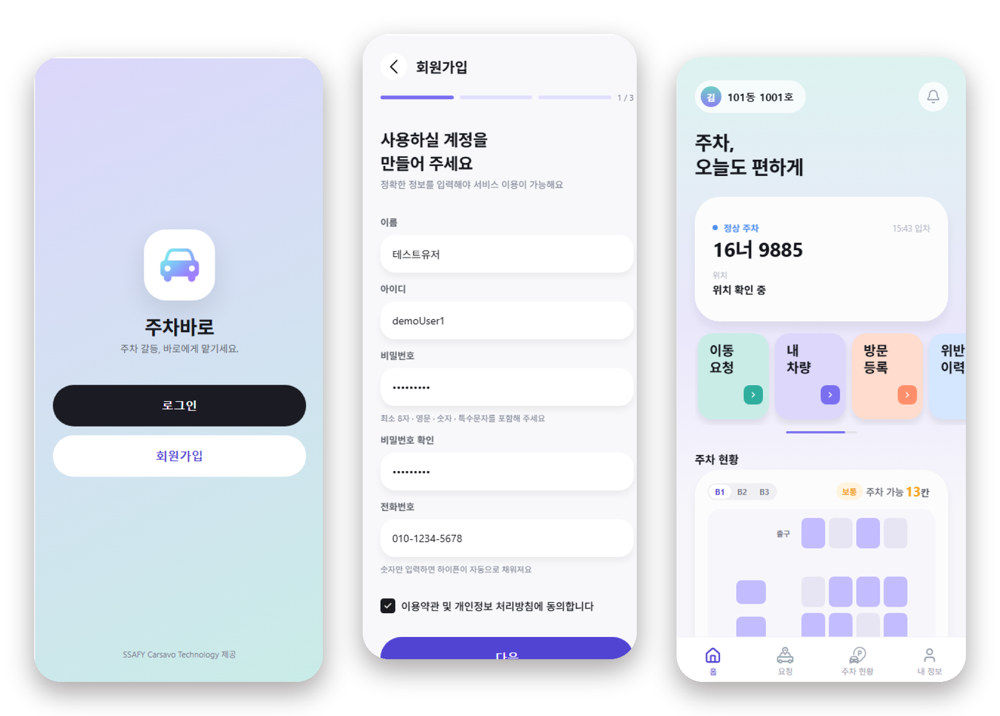
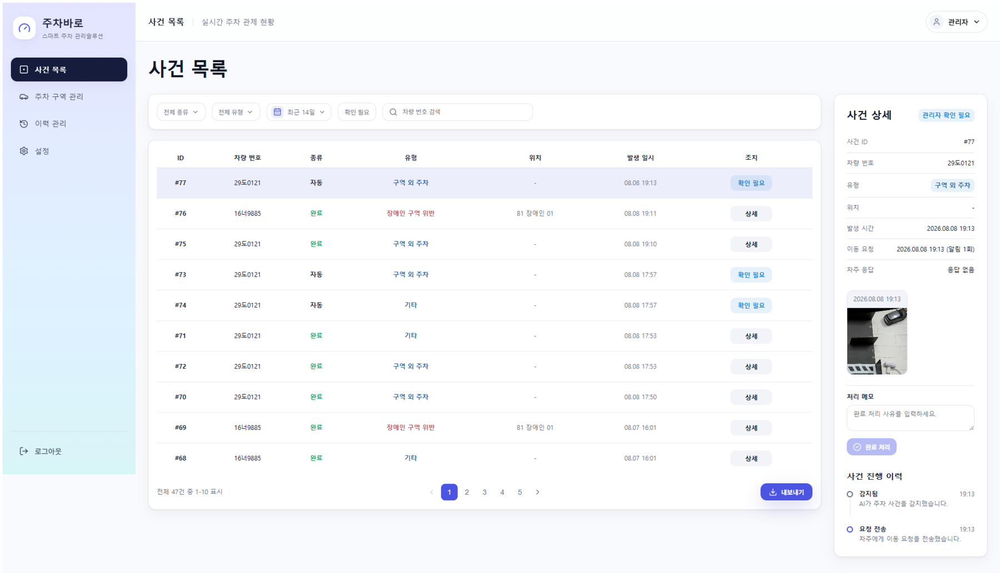
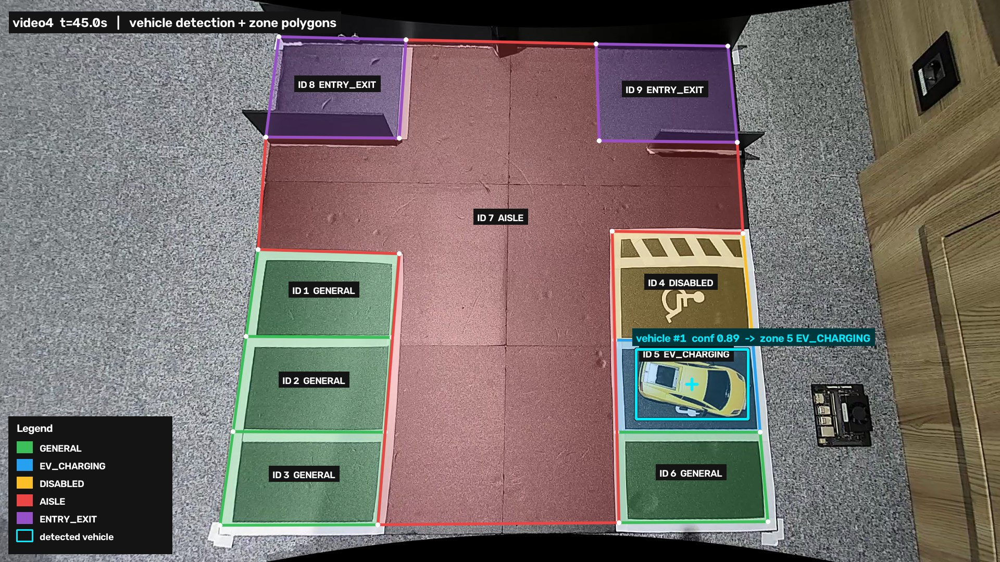
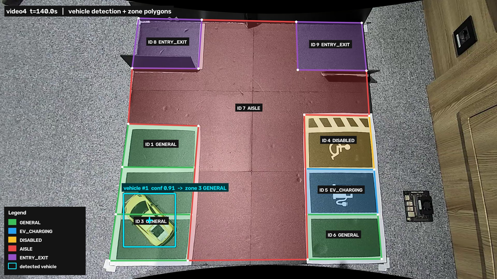
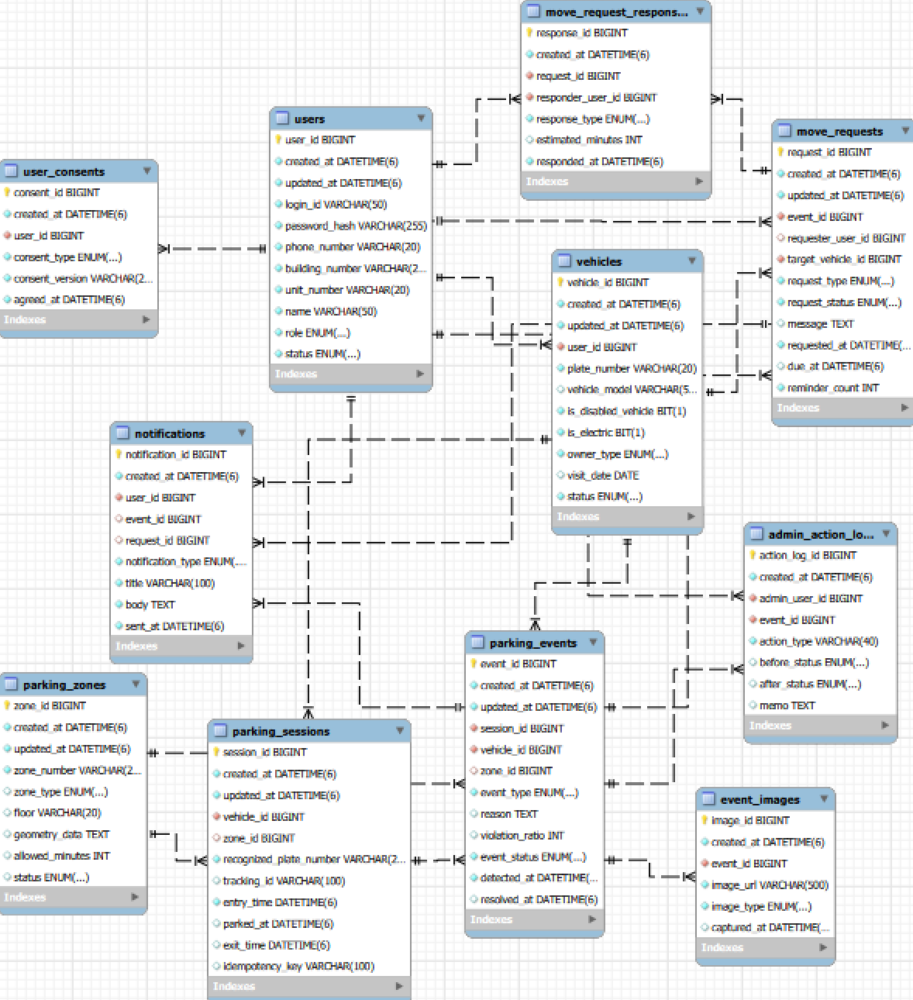

<div align="center">

# 🅿️ 주차바로

**AI 엣지 디바이스가 아파트 주차장의 불편 주차를 자동으로 감지하고,<br>차주의 개인정보를 드러내지 않고 이동 요청부터 실제 이동 확인까지 중계하는 스마트 주차 관리 서비스**


SSAFY 15기 2학기 공통 프로젝트 · 2026.07.06 – 2026.08.14 · 7명

</div>

| 입주민 앱 (React Native) | 관리자 웹 (Vue 3) |
| :---: | :---: |
|  |  |

---

## 한눈에 보기

| 항목 | 내용 |
| --- | --- |
| **문제** | 이중주차·주차선 침범·장애인 및 전기차 구역 무단 점유를 발견해도, 차주에게 직접 연락하거나 관리사무소에 신고해야 한다. 이 과정에서 전화번호·세대 정보가 드러나고, 실제로 차를 뺐는지 다시 확인해야 한다. |
| **해결** | 카메라와 AI가 위반을 감지하면 **감지 → 이동 요청 → 차주 응답 → 현장 재확인**을 자동으로 잇는다. 입주민은 앱으로 요청·응답하고, 관리자는 웹에서 미응답·반복 위반 사건만 판단한다. |
| **구성** | 입주민 앱(React Native) · 관리자 웹(Vue 3) · 백엔드(Spring Boot) · 엣지 디바이스(Jetson Orin Nano, Raspberry Pi) · AI 모델(YOLOv8, PaddleOCR) |
| **내 역할** | 팀장 · 프론트엔드 (입주민 앱 화면과 공통 컴포넌트, 관리자 웹 전체) |
| **기록** | 커밋 1,040개 · MR 261개 — GitLab에서 옮기면서 **MR 번호를 PR 번호로 그대로 유지**했다 (예: MR !146 → [PR #146](https://github.com/nias0ng/juchabaro/pull/146)) |

---

## 내가 맡은 일 — 송가연 (팀장 · Frontend)

팀장으로 일정과 역할을 나누고, 프론트엔드에서는 입주민 앱 화면 일부와 관리자 웹 전체를 맡았다. MR 27개를 올렸다(머지 24개).

### 입주민 앱 (React Native · Expo)

- **가입부터 차량 등록까지 한 흐름으로** — 회원가입 3단계(계정 → 세대 → 확인)와 차량 등록(세대·방문 차량, 전기차·장애인 여부)을 이어 붙이고, 등록 중 상태는 별도 화면이 아니라 오버레이로 처리했다. [#45](https://github.com/nias0ng/juchabaro/pull/45) [#61](https://github.com/nias0ng/juchabaro/pull/61)
- **화면 구현** — 내 차량 관리, 알림 목록·응답 완료(10초 카운트다운 뒤 요청 상세로 복귀), 내 정보·알림 설정, 주차 도면·위반 이력. [#70](https://github.com/nias0ng/juchabaro/pull/70) [#90](https://github.com/nias0ng/juchabaro/pull/90) [#94](https://github.com/nias0ng/juchabaro/pull/94) [#128](https://github.com/nias0ng/juchabaro/pull/128)
- **공통 컴포넌트** — Figma 실측값으로 `MainIcon`·`BackButton`·`BottomNavBar`를 만들고, `Screen`에 헤더·하단 바 슬롯을 두었다. 탭 화면마다 달랐던 헤더·배경 그라데이션·토글을 `ScreenHeader`·`GradientScreenBackground`·`ToggleSwitch`로 합쳤다. [#70](https://github.com/nias0ng/juchabaro/pull/70) [#102](https://github.com/nias0ng/juchabaro/pull/102)
- **주차 현황을 실제 DB 기준으로** — 목업으로 그리던 주차 도면을 관리자 웹과 같은 배치·같은 API 응답으로 바꾸고, 층별 점유·빈자리·혼잡도를 다시 계산했다. [#191](https://github.com/nias0ng/juchabaro/pull/191)

### 관리자 웹 (Vue 3 · Pinia)

- **처음부터 구성** — Vue 3 + Vite + TypeScript + Vue Router + Pinia로 프로젝트를 세우고, 앱의 디자인 토큰·HTTP 클라이언트·인증 스토어를 같은 규칙으로 옮겼다. 라우터 가드로 관리자 로그인을 검사한다. [#140](https://github.com/nias0ng/juchabaro/pull/140)
- **전체 화면 구현** — 사건 목록·상세, 주차 구역 관리, 이력 관리, 설정. 대시보드에 필요한 상태 색은 확장 토큰 `--panel-*`을 oklch로 새로 정의해 라이트·다크 모두 맞췄다. [#146](https://github.com/nias0ng/juchabaro/pull/146) [#148](https://github.com/nias0ng/juchabaro/pull/148)
- **실제 API 연동** — 사건 목록·상세·이력 조회와 완료·반려·확인·재알림 처리를 백엔드 API로 바꾸고, 사건 유형·상태를 백엔드 enum 기준으로 다시 정의했다. 자동/수동 이동 요청 구분과 관리자 확인(`NEED_ADMIN`) 흐름도 반영했다. [#188](https://github.com/nias0ng/juchabaro/pull/188) [#203](https://github.com/nias0ng/juchabaro/pull/203) [#208](https://github.com/nias0ng/juchabaro/pull/208)
- **중복 정리** — 세 화면에 흩어진 CSV 내보내기·페이지네이션 로직을 `use-csv-export`·`use-client-pagination` composable로, 표·필터 마크업을 `DataTable` 등 공용 컴포넌트로 뽑았다. 화면 동작은 그대로 두고 구조만 바꿨다. [#229](https://github.com/nias0ng/juchabaro/pull/229) [#231](https://github.com/nias0ng/juchabaro/pull/231)

### 프로젝트가 끝난 뒤 — 디자인 시스템 개선

회고하면서 앱을 다크 모드로 켜 보니 화면 대부분이 라이트로 남아 있었다. 테마 토큰은 있었지만, 스타일 파일이 모듈 로딩 시점에 만들어지는 고정 객체라 테마를 받을 수 없었다. 그래서 화면 코드가 팔레트(463회)와 색상 값(159회)을 직접 쓰고 있었다. 이 구조를 고치고, 기능 하나(이동 요청)를 끝까지 옮긴 뒤, 린트와 대비 검사로 다시 생기지 않게 막았다.

| 이동 요청 기능의 색 직접 사용 | 대비 기준 미달 | 다크 모드 |
| --- | --- | --- |
| 팔레트 130회 → **0** · 하드코딩 86회 → **0** | 라이트 37개 조합 중 24개 → 39개 중 **0개** | 이동 요청 화면 **5개 지원** |

👉 [케이스 스터디 전문 보기](https://github.com/nias0ng/juchabaro/blob/portfolio/design-system/frontend/baro-app/docs/design-system/portfolio/case-study.md)

---

## 서비스 흐름

> 🚗 **입차** 번호판 인식 → 📷 **위반 감지** 차량 추적·구역 판정 → 📨 **이동 요청** 자동 푸시 → 🙋 **차주 응답** 예상 이동 시간 → 🔁 **현장 재확인** 실제 이동 여부 → 🧑‍💼 미이동·미응답이면 **관리자 판단**

| 구분 | 내용 |
| --- | --- |
| 계정·차량 관리 | 회원가입/로그인, 본인 차량과 방문 차량 등록·조회·수정·삭제 (장애인차·전기차 여부 포함) |
| 입차 인식 | 게이트 카메라로 번호판을 촬영·인식하고 등록 차량과 맞춰 입차 판정 |
| 차량 추적·주차 판정 | 실내 카메라로 차량을 추적하고, 구역 폴리곤으로 점유와 위반(이중주차·구역 외 주차 등) 판정 |
| 이동 요청 | 위반 의심 차량에 사진·사유를 붙여 이동 요청, 요청 목록 조회 |
| 알림 | 이동 요청·재알림·전기차 구역 초과·사건 종료 알림 |
| 장애인·전기차 구역 | 전용 구역 자격 확인, 현장 경고(LED·스피커), 전기차 점유 시간 초과 감지 |

**AI 판정 화면** — 파일럿 영상에 차량 탐지 결과와 구역 폴리곤(일반 · 전기차 충전 · 장애인 · 통행로 · 출입구)을 함께 그린 화면이다.

| 장애인 구역 점유 감지 | 전기차 충전 구역 점유 감지 | 일반 구역 정상 주차 |
| --- | --- | --- |
|  |  |  |

---

## 아키텍처


<details>
<summary><b>ERD · 플로우차트</b></summary>




</details>

---

## 팀 소개

App(모바일 앱·백엔드) · AI · HW(임베디드) 세 영역으로 나누고, 담당 도메인 단위로 역할을 나눴다.

| 이름 | 역할 |
| --- | --- |
| **송가연** | 팀장, App(Frontend) |
| 김채원 | App(Frontend) |
| 오은서 | 서기, Infra, App(Backend) |
| 박시현 | 스크럼 마스터, AI |
| 박신영 | AI, HW |
| 진미리 | 영상 포트폴리오, AI |
| 최지우 | AIoT 장비, HW |

---

## 기술 스택

| 영역 | 기술 |
| --- | --- |
| 입주민 앱 | Expo SDK 54, React Native 0.81, React 19, Expo Router 6, TypeScript 5.9, expo-secure-store |
| 관리자 웹 | Vue 3.5 (`<script setup>`), Vite 8, TypeScript 6, Vue Router 5, Pinia, ESLint · oxlint |
| 백엔드 | Java 21, Spring Boot 4.1, Spring Data JPA, Flyway, MySQL 8.4, Spring Security + JWT, Springdoc OpenAPI |
| AI | YOLOv8n-pose(번호판 검출), PaddleOCR(번호판 인식), YOLOv8s + ByteTrack(차량 추적), Weights & Biases |
| 엣지 디바이스 | Jetson Orin Nano(FastAPI, ONNX + TensorRT), Raspberry Pi(ONNX Runtime · NCNN · PaddleLite), OpenCV fisheye 보정 |
| 인프라 | AWS EC2, Docker Compose, Nginx, Jenkins |
| 협업 | GitLab(→ GitHub 이전), Jira, Notion, Mattermost, Figma |

<details>
<summary><b>세부 기술 선택</b></summary>

**입주민 앱**
- 상태 관리는 React Context/Provider로 충분해 별도 전역 상태 라이브러리를 쓰지 않았다.
- 네트워크는 공통 fetch 래퍼(`services/http-client.ts`)를 직접 만들었다.
- UI 라이브러리 없이 React Native StyleSheet와 자체 디자인 토큰으로 만들었다.

**관리자 웹**
- 앱·백엔드와 같은 공통 응답 포맷(`httpStatus`, `isSuccess`, `message`, `code`, `result`)을 처리한다.
- Pinia 인증 스토어와 `sessionStorage`에 액세스 토큰을 둔다.
- 관리자는 앱과 같은 백엔드 API를 ADMIN 권한으로 쓴다. 회원가입 없이 DB에 관리자 계정을 만든다.

**엣지 디바이스**
- `hw/jetson`은 FastAPI 위에서 카메라 프레임 수집 · 차량 추적 · 구역 판정 · 사건 생성 · LED/스피커 제어 · 백엔드 전송을 하는 모니터링 파이프라인이다.
- 확정된 판정은 로컬 SQLite outbox에 먼저 기록한 뒤 멱등 키를 붙여 백엔드로 보낸다.
- `ai/tracking`은 판정 임계값을 실측·검증하는 베이스라인 스크립트다.

</details>

---

## 핵심 기능 상세

<details>
<summary><b>1. 회원가입 · 로그인 · 차량 관리</b></summary>

- **흐름**: 회원가입 → 로그인(JWT 발급) → 본인 차량/방문 차량 등록(차량 번호, 장애인차·전기차 여부) → 필요하면 수정·삭제
- **처리**: `AuthController`(`/auth/signup`, `/auth/login`)가 계정을 만들고 인증하며, `VehicleController`가 차량 CRUD를 맡는다. 일반 회원가입으로는 RESIDENT 계정만 생기고, 관리자 계정은 신청을 받아 DB에 직접 만든다.

</details>

<details>
<summary><b>2. 게이트 번호판 인식 기반 입차 판정</b></summary>

- **흐름**: 차량 진입 → Raspberry Pi가 초음파 센서로 감지하고 번호판을 촬영·인식 → 인식 결과를 백엔드로 전송
- **처리**: YOLOv8n-pose로 번호판 영역을 찾고 PaddleOCR로 글자를 읽어 `POST /api/hw/parking/entry`로 보낸다. 백엔드는 편집 거리(Levenshtein) 기반 `PlateMatcher`로 등록 차량과 비교해, 완전 일치면 `ALLOW`, 허용 거리 이내면 `REVIEW`, 그 밖은 `DENY`로 판정한다. `ALLOW`일 때만 `ParkingSession`을 만들고, 같은 요청은 idempotency key로 한 번만 처리한다.

</details>

<details>
<summary><b>3. 위반 차량 이동 요청</b></summary>

- **흐름**: 위반 차량 발견 → 번호판·위반 유형·사유·사진을 붙여 이동 요청 → 차주가 예상 이동 시간으로 응답 → 현장 재확인 결과까지 요청 상태에 반영
- **처리**: `MoveRequestController`가 사진 첨부(멀티파트)를 포함한 요청 생성, 목록·상세 조회, 차주 응답을 처리한다. 같은 대상에 처리 중인 요청이 있으면 409로 막는다. 자동 감지 사건은 1시간 동안 응답이 없거나 예상 이동 시각이 지나면, 백엔드가 Jetson에 재확인을 지시하고(`POST /internal/move-verifications`) Jetson이 현장 관측 결과를 회신해 실제 이동 여부를 확정한다.
- **관리자**: `AdminEventController`(`/admin/parking-events`)가 사건 목록·이력·상세 조회와 완료·반려·확인·재알림을 제공한다.

</details>

<details>
<summary><b>4. 알림 조회 및 푸시 발송</b></summary>

- **처리**: `NotificationController`가 페이지 단위로 알림을 조회하고, `DeviceTokenController`가 푸시 토큰을 등록·해제한다. 푸시는 `PushSender` 추상화로 보내며, 운영 프로필은 Expo Push(`ExpoPushSender`), 로컬 기본값은 로그 출력(`LoggingPushSender`)이다. 수신 여부는 `NotificationSettingController`로 설정한다.

</details>

<details>
<summary><b>5. AI 기반 불편 주차 자동 감지</b></summary>

- **흐름**: 입차 때 확보한 번호판-트래킹 ID를 실내 카메라 추적과 매칭 → 주차 구역·통행로 폴리곤과 차량 위치를 비교 → 위반이 확정되면 사건과 증거 이미지를 백엔드로 보내고 이동 요청 자동 생성
- **처리**: `hw/jetson`의 `MonitoringPipeline`이 YOLOv8s + ByteTrack 추적, 구역 겹침 계산, 위반 규칙(이중주차 · 구역 외 주차 · 통행로 방해 · 전용 구역 무자격 주차 · 전기차 초과 점유)을 프레임마다 판정한다.
  - 전용 구역 무자격과 전기차 초과 점유는 단순 진입이 아니라 같은 구역에 `PARKED`된 뒤 확정하고, 전기차 허용 시간은 `parkedAt`부터 센다.
  - 순간적인 변화가 사건이 되지 않도록 규칙마다 확정·해소 대기 시간을 두고, 확정된 전이만 SQLite outbox에 저장한 뒤 멱등 키와 함께 백엔드로 보낸다.
  - 백엔드 `HwIncidentService`는 사건이 열리면 `ParkingEvent`를 만들고 자동 이동 요청과 알림을 보내며, 해소되면 이동 요청을 완료 처리한다.
  - 장애인·전기차 구역은 ToF 센서 판정과 결합해 LED·스피커로 현장 경고를 낸다.
- 판정 임계값은 파일럿 영상 리플레이(`hw/jetson/scripts/replay_pilot_video.py`)와 `ai/tracking` 베이스라인으로 실측해 조정했다.

</details>

<details>
<summary><b>화면 전체 보기</b></summary>

**입주민 앱**


**관리자 웹**


</details>

---

## 실행 방법

<details>
<summary><b>로컬 실행</b></summary>

**사전 요구사항**: Java 21 · Docker / Docker Compose · Node.js 20.x · (선택) Python 3.10+ (`ai`, `hw`를 직접 실행할 때)

**백엔드**

```bash
cd backend
cp .env.example .env   # MYSQL_*, JWT_SECRET 입력
docker compose up -d   # MySQL
./gradlew bootRun      # local 프로필, 포트 8080 (Windows: gradlew.bat bootRun)
```

- Swagger UI: `http://localhost:8080/swagger-ui/index.html`
- Health Check: `http://localhost:8080/actuator/health`

**입주민 앱**

```bash
cd frontend/baro-app
cp .env.example .env.local   # EXPO_PUBLIC_API_BASE_URL 등 입력
npm install
npm start          # Expo 개발 서버 (android / ios / web 스크립트도 있음)
```

**관리자 웹**

```bash
cd frontend/baro-web/admin-web
cp .env.example .env.local   # VITE_API_BASE_URL 등 입력
npm install
npm run dev
```

**엣지 서버 (Jetson Orin Nano)**

```bash
cd hw/jetson
python -m venv .venv && source .venv/bin/activate
python -m pip install -r requirements.txt
cp .env.example .env    # 카메라·캘리브레이션·모델 경로 입력
python -m uvicorn src.main:app --host 0.0.0.0 --port 8000
```

카메라·캘리브레이션·모델 자산이 유효하지 않으면 시작 단계에서 멈춘다. 상태 확인은 `/health`, API 문서는 `/docs`.

**게이트 번호판 인식 (Raspberry Pi)**

```bash
cd hw/raspberry-pi
python -m pip install -r requirements.txt
python scripts/download_models.py   # 번호판 탐지 + 한국어 PaddleOCR ONNX 모델
python -m src.main
```

**모델 학습**

```bash
uv venv ai/training/.venv --python 3.12
uv pip install --python ai/training/.venv -r ai/training/requirements.txt
cd ai/training
python scripts/train_yolo.py --config configs/yolo_vehicle.yaml   # 차량 탐지
python scripts/train_yolo.py --config configs/yolo_plate.yaml     # 번호판 탐지
```

**운영 환경 (Docker)**

```bash
cd backend
docker compose -f compose.prod.yaml up -d
```

</details>

---

## 협업 방식

<details>
<summary><b>브랜치 · 커밋 · MR · Jira 규칙</b></summary>

**브랜치**
- `main`(발표·배포) ← `develop`(통합) ← 작업 브랜치
- 이름: `<작업종류>/<모듈명>/<Jira 키>-<설명>` (예: `feature/be/46-alert-api`)
- 작업종류: `feature` · `fix` · `refactor` · `test` · `docs` · `chore` / 모듈명: `ai` · `be` · `fe` · `hw` · `infra` · `common`

**커밋**
- `<종류>(<모듈명>): <작업 내용>`, 커밋 하나에 변경 하나

**Merge Request**
- 제목: `[모듈][작업종류] 작업 내용 (Jira 키)`
- 본문: 관련 Jira Task / 변경 내용 / 확인이 필요한 부분 / 테스트 방법
- 일반 MR은 1명 이상, `develop → main`은 2명 이상 승인
- `main`, `develop`은 직접 push · force push 금지

**Jira**
- Epic → Story(`[사용자]로서, [목적]을 위해 [기능]을 원한다`) → Task
- 1 Task = 1 담당자 = 1 브랜치 = 1 MR, 워크플로 `To Do → In Progress → In Review → Done`

</details>

---

## 산출물

- [ERD (ERDCloud)](https://www.erdcloud.com/d/PfvfjfKdzG5ETYMuB)
- [와이어프레임 (Figma)](https://www.figma.com/design/zMdVDC8rF1GC2dBgN3tDkT/%EC%8A%A4%EB%A7%88%ED%8A%B8-%EC%A3%BC%EC%B0%A8%EC%9E%A5--%EC%A3%BC%EC%B0%A8%EB%B0%94%EB%A1%9C?node-id=4009-3157&t=wSUHblFHuHAsAXMN-1)
- [팀 노션](https://app.notion.com/p/SSAFY-2-1-396967bab5a4804faef3f3def764090a?source=copy_link) · [API 명세 (Notion)](https://app.notion.com/p/API-3a4967bab5a480c98ffdf9e7dbb38a2f?source=copy_link)
- [Android 앱 번들 (Google Drive)](https://drive.google.com/drive/folders/1m4rUBzDPmmm41PEe1OWc4jHygtWS2sUb?usp=sharing)
- 배포 서버(관리자 웹 · Swagger)는 프로젝트 기간에만 운영했다.

```
📂 ai         # 모델 학습 · OCR · 추적 베이스라인
📂 backend    # Spring Boot API
📂 frontend   # baro-app(입주민 앱) · baro-web/admin-web(관리자 웹)
📂 hw         # jetson(엣지 서버) · raspberry-pi(게이트)
📂 docs       # 아키텍처 · 다이어그램 · 이미지
📂 exec       # 빌드·배포 매뉴얼, 시연 시나리오
```
