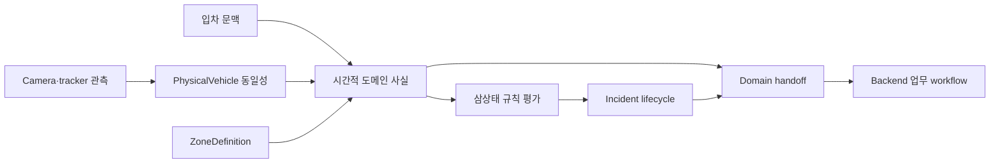

# Jetson 도메인 목적 및 출력 계약

> 상태: Draft · 관련 이슈: S15P11E202-461 · 책임: 도메인 사실과 cross-system handoff의 의미

이 문서는 Jetson이 어떤 사실을 확정하고 외부에 무엇을 전달하는지 정의한다. 상태 전이는 [Scope 수명주기 계약](./02-scope-lifecycle-contract.md), 전파는 [Scope 전파 및 종료 계약](./03-scope-propagation-contract.md), 저장과 재전송은 [상태 보존 및 Retention 계약](./04-durable-state-and-retention-contract.md)이 담당한다.

## 1. 목적

Jetson은 camera·tracker·입차 문맥의 불완전한 입력을 시간에 걸쳐 해석하여 Backend가 사용할 수 있는 안정적이고 설명 가능한 도메인 전이로 만든다.

한 frame의 bbox나 tracker ID는 다음을 직접 증명하지 못한다.

- 직전 frame과 현재 frame의 차량이 같은 물리 차량인지
- 차량이 구역을 통과하는 중인지 실제로 머무는 중인지
- 잠시 멈춘 것인지 주차가 확정됐는지
- 한 frame에서 보이지 않는 것인지 실제로 떠났는지
- 이동한 뒤 기존 위반 원인도 사라졌는지
- 새 사건인지 이미 공개한 사건의 연속인지

Jetson의 `Incident.OPEN`은 edge 규칙의 확정 조건이 충족됐다는 뜻이다. 법적 판단이나 관리자 최종 확정을 의미하지 않는다.

## 2. 판단 계층



| 계층 | 결과 | 책임 |
|---|---|---|
| 관측 | detection, track, frame health, `MotionEstimate` | 보이는 것과 시간적 bbox evidence를 보고하며 scope 수명이나 종료를 추정하지 않음 |
| 동일성 | `PhysicalVehicle` | `EntityResolver`가 한 frame 전체의 시공간 geometry를 전역 1:1로 비교해 여러 track segment의 물리적 연속성을 결정 |
| 시간적 사실 | `ZoneVisit`, `ParkingEpisode`, `BlockingRelation` | 공간·정지·관계의 confirmation |
| 규칙 평가 | `MATCHED / NOT_MATCHED / UNKNOWN` | 현재 규칙 술어만 계산하며 상태를 소유하지 않음 |
| 사건 | `Incident` | 후보·OPEN·clear·RESOLVED와 중복 억제 |
| 전달 | immutable handoff와 outbox | Backend 적용 여부와 retry |
| 업무 | event, 이동 요청, 알림, 관리자 처리 | Backend 책임 |

## 3. 독립적인 상태축

### 3.1 Domain state

현장에서 어떤 사실이 성립하는지를 나타낸다.

```text
ZoneVisit.INSIDE
ParkingEpisode.PARKED
BlockingRelation.BLOCKING
Incident.OPEN
```

### 3.2 Observation state

현재 그 사실을 신뢰 가능하게 관측할 수 있는지를 나타낸다.

```text
OBSERVED
DEGRADED
UNKNOWN
```

`UNKNOWN`은 긍정도 부정도 확인할 수 없다는 뜻이다. `OUTSIDE`, `UNPARKED`, `RESOLVED`, `EXITED`로 번역하지 않는다.

다음 두 상황은 다르다.

```text
카메라·pipeline 장애 또는 가림으로 차량을 판단할 수 없음
→ UNKNOWN

카메라와 전체 관리 영역이 정상이고 연속된 유효 frame에서 차량 부재를 확인함
→ 신뢰 가능한 NOT_PRESENT_CONFIRMED 관측
```

`NOT_PRESENT_CONFIRMED`의 구체적인 confirmation 시간은 설정값이며, 단순 tracker timeout과 같지 않다.

`IdentityResolution(CONTINUED / REIDENTIFIED / CREATED / UNRESOLVED)`과
`allIdentitiesResolved`는 이 세 상태축에 추가되는 영속 상태가 아니다. 이는
EntityResolver의 이번 frame 결정을 설명하는 ephemeral projection이다. 결정이
`UNRESOLVED`이면 observation은 `UNKNOWN / REIDENTIFICATION_UNCERTAIN`이고,
Domain state와 Delivery state를 바꾸지 않은 채 trusted timer만 멈춘다.

`MotionEstimate(MOVING / STATIONARY / UNKNOWN)`와 그 reason·window 지표도
새 상태축이나 영속 scope가 아니다. MotionEstimator가 resolved
PhysicalVehicle의 bbox와 관측 시각만으로 만든 ephemeral evidence다. bbox와
identity는 정상인데 표본 수·관측 span이 부족하거나 sample gap·dead band 때문에
motion만 `UNKNOWN`일 수 있다. 이때 PhysicalVehicle, ZoneVisit과 현재 assignment
geometry의 observation은 `OBSERVED`를 유지하고, ParkingEpisode와 PARKED에
의존하는 규칙처럼 motion을 필수 입력으로 쓰는 scope만
`UNKNOWN / DEPENDENCY_UNAVAILABLE`로 timer를 멈춘다. motion 불확실성을
`UNPARKED`, `RESOLVED` 또는 차량 부재로 번역하지 않는다.

### 3.3 Delivery state

공개하기로 확정한 handoff가 Backend에 적용됐는지를 나타낸다.

```text
PENDING
IN_FLIGHT
RETRY_WAIT
DELIVERED
FAILED_TERMINAL
```

HTTP 실패는 domain state를 되돌리지 않는다. retry는 동일한 publication revision, Idempotency-Key와 payload를 사용한다.

### 3.4 유효한 조합

다음 상태는 모순이 아니다.

```text
Incident.domain      = OPEN
Incident.observation = UNKNOWN
OPEN.delivery        = DELIVERED
```

카메라 장애가 이미 확정한 사건을 없애지 않으며, 전달 성공이 현재 관측의 신뢰성을 보장하지도 않는다.

## 4. 도메인 구성요소

| 구성요소 | 의미 | 주요 비책임 |
|---|---|---|
| `TrackSegment` | tracker가 연속으로 부여한 일시적 관측 구간 | 물리 차량·주차·사건의 수명 결정 |
| `PhysicalVehicle` | Jetson이 같은 실차로 보는 연속성 | 등록 차량 또는 session identity 대체 |
| `EntryMatchAttempt` | 한 입차 시도와 PhysicalVehicle의 비동기 매칭 | 접근 허용·관리자 심사 결정 |
| `ContextBinding` | PhysicalVehicle과 확정된 session/context의 연결 | 위치·주차·위반 사실 소유 |
| `ParkingSessionMirror` | Backend session의 Jetson 측 현장 범위 | Backend 업무 상태 전체 복제 |
| `ZoneVisit` | PhysicalVehicle과 한 ZoneDefinition 사이의 연속 방문 | 주차 완료 판정 |
| `ParkingEpisode` | 정지 후보부터 주차 확정과 이동 확인까지의 행위 | 위반 Incident의 자동 수명 소유 |
| `ParkingAssignment` | episode에서 안정화한 대표 주차 위치 | 독립 lifecycle |
| `BlockingRelation` | subject·victim·egress 영역의 차단 관계 | 모든 공간 관계의 범용 graph |
| `Incident` | 동일 규칙 위반의 후보·OPEN·해소 수명 | Backend 업무 완료 상태 소유 |
| `MoveVerificationAttempt` | 이동 요청 뒤 현장 규칙을 다시 확인하는 한 번의 시도 | Backend 재알림·관리자 전환 결정 |

## 5. ZoneDefinition

### 5.1 기본 타입

`[결정]` Jetson의 기본 Zone 타입은 다음 다섯 가지다.

```text
GENERAL
DISABLED
EV_CHARGING
AISLE
ENTRY_EXIT
```

`EV_FAST`, `EV_SLOW`는 기본 타입으로 두지 않는다. 충전 속도에 따라 정책이 달라질 때 `EV_CHARGING`의 선택 속성 또는 허용 시간으로 표현한다.

### 5.2 최소 정의

ZoneDefinition은 최소한 다음 의미를 제공한다.

```text
zoneId
zoneType
polygon
zoneDefinitionVersion
calibration reference
optional allowedDurationSeconds
optional chargerClass
optional egressZoneIds
```

- ParkingAssignment 대상 타입은 `GENERAL / DISABLED / EV_CHARGING`이다.
- `AISLE / ENTRY_EXIT`은 관측·판정용이며 주차면 assignment 대상이 아니다.
- `allowedDurationSeconds`와 `chargerClass`는 `EV_CHARGING`에서만 유효하다.
- `egressZoneIds`는 주차면에서 빠져나가는 경로를 나타내는 AISLE zone 참조이며 DOUBLE_PARKING 평가에 사용한다.
- 다섯 타입 모두 하나의 deployment `zoneId` namespace를 사용한다. Backend·Frontend는 그중 주차면 타입만 업무 화면에 projection할 수 있다.

`[결정]` 활성 ZoneVisit은 시작 당시의 `zoneId + zoneDefinitionVersion`을 보존한다. 현재 한 대의 Jetson에는 version이 명시된 정적 JSON 설정을 배포한다. 실행 중 hot replacement와 동적 동기화 서비스는 지원하지 않으며, ZoneDefinition 변경은 active scope가 없는 통제된 기동 시점에 적용한다.

### 5.3 정적 JSON 배포 형식

Jetson은 `ZONE_DEFINITION_PATH`가 가리키는 UTF-8 JSON 파일 전체를 기동 시 읽는다. JSON은 SQLite로 옮기지 않으며, 일부 구역만 적용하거나 오류 항목을 건너뛰지 않는다. 현재 메인 배포 정본은 crop하지 않은 full-frame 좌표계의 `config/zone_definition.json` version 1이다. 좌측 crop 실험용 `config/zone_definition.pilot.json` version 6은 메인 배포 정본이 아니다.

```json
{
  "zoneDefinitionVersion": 1,
  "calibrationReference": "a5d846f6bfc40eb3",
  "zones": [
    {
      "zoneId": 1,
      "zoneType": "GENERAL",
      "polygon": [[0.1, 0.1], [0.3, 0.1], [0.3, 0.3], [0.1, 0.3]],
      "egressZoneIds": [2]
    },
    {
      "zoneId": 2,
      "zoneType": "AISLE",
      "polygon": [[0.3, 0.1], [0.5, 0.1], [0.5, 0.3], [0.3, 0.3]]
    }
  ]
}
```

- 최상위 필드는 `zoneDefinitionVersion`, `calibrationReference`, `zones`다.
- zone 필수 필드는 `zoneId`, `zoneType`, `polygon`이며 선택 필드는 `allowedDurationSeconds`, `chargerClass`, `egressZoneIds`다.
- 좌표는 `[x, y]` 순서의 0~1 정규화 값이고, 모든 zone은 같은 calibration 좌표계를 사용한다.
- `zoneId`는 snapshot 안에서 유일해야 한다.
- `egressZoneIds`는 주차면 타입에서만 사용하며 같은 snapshot의 `AISLE`을 참조한다. 생략하면 빈 관계다.
- 구형 `EV_FAST`, `EV_SLOW`, `allowedMinutes`는 받지 않는다.

## 6. 공통 도메인 결정

### 6.1 식별자와 revision

- scope ID는 도메인 동일성을 표현한다.
- `publicationRevision`은 같은 aggregate의 공개 전이 순서를 표현한다.
- `Idempotency-Key`는 같은 공개 전이의 네트워크 retry를 식별한다.
- `deliveryAttempt`는 전송 횟수이며 domain revision이 아니다.

`[결정]` Incident는 `CANDIDATE` 생성 시 `incidentId`를 발급한다. Candidate는 별도 `IncidentCandidate` aggregate가 아니라 Incident의 공개 전 상태다. OPEN 전에는 ID와 상태를 외부에 노출하지 않으며 첫 외부 publication은 revision 1이다.

### 6.2 시간 누적

정지, 구역 진입·이탈, Incident confirm·clear 시간은 신뢰 가능한 관측 구간만 누적한다. camera unavailable, 판단 불가 구간과 process downtime을 wall-clock 차이로 보충하지 않는다.

주차 확정에는 [Scope 수명주기 계약의 직접 설정값](./02-scope-lifecycle-contract.md#14-직접-설정값)을 사용한다. ParkingEpisode는 생성 시 실제 적용된 scalar 값을 snapshot으로 보존하므로 실행 중 설정 변경이 진행 중 episode를 소급 변경하지 않는다.

EV 장기 주차 허용 시간은 `parkingConfirmationDurationSeconds`와 다른 정책값이다. 실제 법령 값·출처와 UNKNOWN 구간에 wall-clock을 계속 셀지 여부는 `[후속 계약]`으로 확정한다.

### 6.3 후보 취소와 사건 해소

- 공개되지 않은 Candidate가 사라지면 `CANCELED`이며 publication은 없다.
- OPEN된 Incident의 술어가 사라지면 동일 `incidentId`로 `RESOLVE`한다.
- terminal Incident는 재활성화하지 않는다. clear 확인 뒤 다시 성립하면 새 `incidentId`다.

### 6.4 이동과 Incident 재평가

`[결정]` 신뢰 가능한 이동은 ParkingEpisode를 끝내고 필요한 경우 `UNPARKED`를 만든다. 그러나 어떤 Incident도 이동만으로 RESOLVE하지 않는다.

```text
ParkingEpisode ENDED / MOVEMENT_CONFIRMED
→ 연관 Incident에 REEVALUATE trigger
→ MATCHED: 기존 Incident 유지
→ NOT_MATCHED: CLEAR_PENDING 뒤 RESOLVE
→ UNKNOWN: 기존 lifecycle 유지, timer 정지
```

`REEVALUATE`는 영속 domain state가 아니라 최신 geometry·context·관측으로 규칙을 다시 계산하라는 trigger다.

BAD_PARKING·OUT_OF_ZONE·AISLE_BLOCK처럼 PARKED가 OPEN 조건인 규칙에서는 movement 뒤 아직 새 ParkingEpisode가 PARKED되지 않았다는 이유만으로 `NOT_MATCHED`를 만들지 않는다. 다만 한 신뢰 가능한 평가 sample에서 규칙에 필요한 geometry·assignment가 모두 유효하고 위반 술어가 false이면 `NOT_MATCHED`다. clear 시간은 RuleEvaluator가 아니라 IncidentReducer가 누적한다. 필수 입력을 아직 판단할 수 없으면 `UNKNOWN / confirmable=false`로 기존 Incident를 유지한다.

### 6.5 장기 UNKNOWN

장기 UNKNOWN은 domain 종료 조건이 아니라 operational health 문제다. Scope의 ObservationState는 UNKNOWN으로 유지한다. Jetson은 camera heartbeat, 마지막 유효 frame·inference 시각과 UNKNOWN 지속 시간을 이용해 별도 operational health를 `DEGRADED`로 보고할 수 있지만 시간 경과만으로 Incident를 해소하지 않는다. 장치 단독으로 가능한 범위는 이 상태를 탐지·노출하는 것까지이며, 알림 전달과 관리자 확인은 Backend·운영 책임이다.

사각지대가 없는 현재 모형에서는 camera와 전체 관리 영역이 정상인 동안 설정된 확인 시간만큼 해당 차량이 없다는 관측을 얻으면 물리적 부재 근거로 사용할 수 있다. 이 근거가 없으면 상태를 유지한다.

## 7. 입차 문맥과 미등록 차량

`[결정]` 한 물리적 입차 인식 시도에는 ALLOW·REVIEW·DENY 모두에서 유지되는 `entryAttemptId`가 있다. 현재 wire의 `trackingId`를 이 의미로 정규화하며, 최종 필드명은 `[후속 계약]`에서 결정한다.

`entryAttemptId`는 다음과 다르다.

- ByteTrack의 `trackSegmentId`
- Jetson의 `physicalVehicleId`
- Backend가 ALLOW 또는 REVIEW 승인 뒤 생성하는 `sessionId`
- HTTP retry의 Idempotency-Key

Access decision과 현장 매칭 결과는 독립적이다.

| Access decision | Jetson의 처리 |
|---|---|
| `ALLOW` | session/context와 PhysicalVehicle이 모두 확인되면 `ContextBinding` 생성 |
| `REVIEW` | PhysicalVehicle 매칭은 계속할 수 있으나 자격은 `UNKNOWN`; 관리자 결정 전 authoritative session binding 금지 |
| `DENY` | 실제 차량 관측은 유지하되 session·등록 차량 context를 추론하지 않음 |

REVIEW·DENY를 `EntryMatchAttempt.FAILED`로 번역하지 않는다. session이 없는 차량도 `PhysicalVehicle`, ZoneVisit과 local evidence를 가질 수 있다.

`[결정]` REVIEW·DENY 차량의 IncidentTransition은 `entryAttemptId + physicalVehicleId`로 Backend에 공개하며 조용히 버리지 않는다. `sessionId`는 선택적이다. Backend가 이를 접수·저장하고 관리자에게 노출하는 request/response와 DB 형태는 `[후속 계약]`이다.

Jetson 기동 당시 이미 구역 안에 있어 `entryAttemptId`도 session도 없는 차량은 authoritative correlation이 생길 때까지 Incident를 local-only로 유지한다. 외부 공개를 위해 임의의 entryAttemptId나 sessionId를 만들지 않는다.

## 8. 출력 의미

### 8.1 EntryMatchOutcome

`EntryMatchOutcome`은 `entryAttemptId`와 PhysicalVehicle의 매칭 결과다.

```text
MATCHED / EXPIRED / FAILED / CANCELED
```

이는 Incident처럼 지속 갱신하는 publication이 아니라 입차 command의 멱등 결과다. REVIEW 상태에서는 물리 매칭이 성공해도 session binding은 아직 없을 수 있다.

### 8.2 PARKED와 UNPARKED

`PARKED`는 동일 PhysicalVehicle이 `parkingConfirmationDurationSeconds` 동안 신뢰 가능하게 정지했다는 사실이다. `UNPARKED`는 PARKED episode에서 신뢰 가능한 이동이 확인됐다는 사실이다.

- UNKNOWN 동안 timer를 멈춘다.
- session binding 전에도 내부 PARKED는 확정할 수 있다.
- session이 필요한 외부 PARKED publication은 binding까지 보류한다.
- 늦은 binding이 retention 안에 도착하면 원래 `occurredAt`을 유지하며 PARKED와 후속 UNPARKED를 revision 순서대로 만든다.
- binding이 끝내 생기지 않으면 session-scoped publication은 만들지 않는다.
- 실제 Session EXIT로 끝난 episode에는 별도 UNPARKED를 만들지 않는다.

### 8.3 Incident OPEN과 RESOLVE

`RuleEvaluator`는 현재 사실을 `MATCHED / NOT_MATCHED / UNKNOWN`으로 계산하고, `IncidentReducer`만 Incident 상태를 바꾼다.

```text
domain facts
→ IncidentSignal
→ IncidentReducer
→ CANDIDATE / OPEN / CLEAR_PENDING / RESOLVED
→ OPEN·RESOLVE publication
```

OPEN은 edge confirm 조건이 충족됐음을 의미한다. RESOLVE는 같은 Incident 술어의 불성립 또는 실제 Session EXIT처럼 계약된 종료 근거가 확인됐음을 의미한다. tracker 소실, camera unavailable, process restart는 RESOLVE 근거가 아니다.

### 8.4 Evidence

EvidenceArtifact는 새로운 위반 사실이 아니라 Incident를 뒷받침하는 immutable 정지 이미지다.

- Candidate 단계부터 동일 `incidentId`에 연결할 수 있다.
- OPEN transaction에서 대상 publication revision에 귀속한다.
- checksum, capturedAt, image type과 local file 상태를 가진다.
- Incident RESOLVE 뒤에도 이미 생성한 evidence 전달은 독립적으로 완료한다.
- 파일을 보존할 수 없으면 성공으로 가장하지 않고 손실 사유와 metadata를 남긴다.

원본 CCTV 영상은 EvidenceArtifact가 아니며 Jetson의 장기 보존 대상이 아니다.

### 8.5 Session EXIT

EXIT는 session에 연결된 PhysicalVehicle이 주차장을 떠났다는 현장 사실이다. 현재 사각지대 없는 모형에서는 `ENTRY_EXIT_TRAVERSAL` 또는 정상 전체 관측의 `FULL_AREA_ABSENCE`를 exit evidence로 사용할 수 있다.

Backend의 행정적 `CLOSED`, 취소나 데이터 정정을 EXIT로 번역하지 않는다. Backend가 실제 출차 확인을 authoritative input으로 제공하는 경로는 현재 계약에 포함하지 않으며 `[후속 계약]`에서 종료 사유와 재발행 금지를 함께 정한다. 현재 SessionExit handoff는 `JETSON_EXIT_CONFIRMED` origin에서만 만든다.

### 8.6 MoveVerificationResult

한 command attempt는 비어 있지 않은 `targetIncidentIds`를 대상으로 하며 다음 중 하나의 immutable 전체 결과를 만든다.

```text
RESOLVED
STILL_ACTIVE
UNKNOWN
```

이동 자체가 아니라 대상별 최신 Incident 술어가 결과를 결정한다. 결과는 incidentId별 판정도 함께 가진다. Backend의 `COMPLETED`, `REMINDER_SENT`, `NEED_ADMIN` mapping은 `[후속 계약]`이다.

Incident가 `CLEAR_PENDING`이면 아직 RESOLVED가 아니므로 해당 대상 결과는 clear confirmation이 끝날 때까지 `UNKNOWN`이다. pilot은 target을 한 개만 보낼 수 있지만 identity를 1:1로 고정하지 않기 위해 의미 계약은 하나 이상의 목록을 허용한다. 한 command의 모든 target은 같은 이동 대상 `subjectPhysicalVehicleId`를 가져야 한다.

## 9. 규칙과 Incident 동일성

`IncidentKey`는 규칙마다 다음 값으로 고정한다. 평가 근거가 바뀌었다고 key를 새로 만들지 않는다.

| 규칙 그룹 | IncidentKey |
|---|---|
| 전용구역·EV 초과 | `zoneVisitId + ruleCode` |
| BAD_PARKING·OUT_OF_ZONE·AISLE_BLOCK | `physicalVehicleId + ruleCode` |
| DOUBLE_PARKING | `blockingRelationId + ruleCode` |

ParkingEpisode, ParkingAssignment와 spot·zone 변경은 parking rule의 평가 근거일 뿐 IncidentKey가 아니다. 이동 뒤 새 ParkingEpisode가 생겨도 같은 PhysicalVehicle에서 위반 술어가 이어지면 같은 Incident를 유지한다.

| Rule code | continuity key | OPEN 핵심 조건 | 주요 해소 조건 |
|---|---|---|---|
| `DISABLED_ZONE_UNAUTHORIZED` | `zoneVisitId` | confirmed INSIDE + 자격 `false` | ZoneVisit ENDED 또는 자격 정정 뒤 NOT_MATCHED |
| `EV_ZONE_UNAUTHORIZED` | `zoneVisitId` | confirmed INSIDE + EV 자격 `false` | ZoneVisit ENDED 또는 자격 정정 뒤 NOT_MATCHED |
| `EV_OVERSTAY` | `zoneVisitId` | 계약된 visit duration이 허용 시간 초과 | ZoneVisit ENDED |
| `BAD_PARKING` | `physicalVehicleId` | PARKED + 안정된 assignment에서 술어 성립 | 이동 후 confirmed NOT_MATCHED 또는 confirmed vehicle departure |
| `OUT_OF_ZONE` | `physicalVehicleId` | PARKED + 유효한 주차면 assignment 없음 | 유효 assignment 또는 confirmed vehicle departure |
| `AISLE_BLOCK` | `physicalVehicleId` | PARKED + 통행로 침범 술어 성립 | 침범 불성립 또는 confirmed vehicle departure |
| `DOUBLE_PARKING` | `blockingRelationId` | confirmed BlockingRelation | BlockingRelation RESOLVED 또는 관련 차량의 confirmed departure |

자격이나 필수 정책이 없으면 무자격으로 추정하지 않고 `UNKNOWN`이다. 불량 주차 계열은 PARKED 전에도 후보를 계산할 수 있지만 `confirmable=false`이며 OPEN하지 않는다.

## 10. Cross-system handoff 정본

이 표는 의미 수준의 정본이다. endpoint, DTO 필드명, HTTP 상태, 인증과 timeout은 `[후속 계약]`이다.

| Handoff | 방향·권위 | 발생 의미 | Identity·필수 의미 참조 | 수신 측 의무 |
|---|---|---|---|---|
| `EntryDecision` | RPi/Backend → Jetson · Backend | ALLOW·REVIEW·DENY와 선택적 session/context | `entryAttemptId + decisionRevision`; ALLOW면 session/context 필수 | retry·stale revision 구분 |
| `EntryReviewResolution` | Backend → Jetson · Backend/admin | REVIEW_ALLOW·REVIEW_DENY·REVIEW_EXPIRED | `entryAttemptId + decisionRevision`; ALLOW면 session/context 필수 | REVIEW_PENDING의 더 높은 첫 resolution만 적용; settled 뒤 변경은 conflict |
| `EntryMatchOutcome` | Jetson → Backend/RPi · Jetson | 입차 시도와 PhysicalVehicle의 매칭·만료 결과 | `entryAttemptId + physicalVehicleId? + outcome` | 동일 결과 멱등 처리 |
| `SessionContextUpdate` | Backend → Jetson · Backend | session 행정 상태와 같은 binding의 차량 자격 갱신 | `sessionId 또는 entryAttemptId + contextRevision` | same revision conflict 거부, 관련 규칙 재평가 |
| `ZoneDefinitionSnapshot` | 설정 권위 → Jetson · 배포 설정 | 전체 polygon과 zone별 직접 scalar 필드 | `zoneDefinitionVersion`; 모든 zoneId와 relation 포함 | active scope 없는 기동에서 원자 적용 |
| `ParkingTransition` | Jetson → Backend · Jetson | PARKED 또는 UNPARKED | `parkingEpisodeId + publicationRevision`; sessionId·occurredAt와 assignment zoneId 또는 unassigned reason 필수 | aggregate revision 순서로 적용 |
| `IncidentTransition` | Jetson → Backend · Jetson | OPEN 또는 RESOLVE | `incidentId + publicationRevision`; physicalVehicleId·ruleCode·occurredAt, rule별 zone·relation·victim context, sessionId 또는 entryAttemptId 중 하나 이상 필수 | session 없는 사건도 수용하고 revision 멱등 처리 |
| `EvidenceArtifact` | Jetson → Backend · Jetson | 특정 Incident revision의 정지 이미지 | `evidenceId + incidentId + publicationRevision + checksum` | checksum 검증과 적용 결과 반환 |
| `EvidenceUnavailable` | Jetson → Backend · Jetson storage | artifact가 resource limit·retention·손상으로 제공 불가 | `evidenceId + incidentId + publicationRevision + reason + unavailableAt`; checksum·byteSize는 생성됐으면 포함 | 성공 upload와 구분해 적용 확인 |
| `SessionExit` | Jetson → Backend · Jetson observation | Jetson이 확인한 실제 출차 | `sessionId + publicationRevision + occurredAt`; origin=JETSON_EXIT_CONFIRMED | 행정 종료와 구분해 적용 |
| `MoveVerificationCommand` | Backend → Jetson · Backend | 하나 이상 Incident의 현장 재확인 요구 | `requestId + verificationAttempt + targetIncidentIds` | 동일 command 중복 실행 금지 |
| `MoveVerificationResult` | Jetson → Backend · Jetson | 전체·incident별 RESOLVED·STILL_ACTIVE·UNKNOWN | command identity + incident별 판단 revision | 업무 상태 mapping과 후속 행동 결정 |
| `PublicationApplicationConfirmation` | Backend → Jetson · Backend | APPLIED·ALREADY_APPLIED·CONFLICT | aggregate ID + publicationRevision + payload hash + correlation | ACK 유실 시 적용 여부를 안전하게 재확인; 구체 방식은 후속 계약 |

Backend→Jetson handoff는 identity와 revision으로 중복·stale·conflict를 구분할 수 있어야 한다. retry, reconnect와 durable acceptance의 구체적인 transport 방식은 `[후속 계약]`이며 full state snapshot protocol은 현재 범위에 넣지 않는다.

## 11. 책임 경계와 후속 결정

Jetson은 다음을 결정하지 않는다.

- 알림 수신자·문구·채널
- MoveRequest 생성·병합·재알림·관리자 전환
- Backend event의 업무상 최종 해결 여부
- Frontend의 session·spot·violation read model
- 법적 위반의 최종 판정

다음은 Jetson 도메인 이후 연동 계약에서 반드시 정한다.

1. 위 handoff별 request/response와 nullable 규칙
2. `entryAttemptId`의 최종 wire 명칭
3. 미등록·REVIEW 차량 Incident의 Backend 저장·관리자 노출 형태
4. Jetson rule code와 Backend event type의 mapping
5. 여러 동시 Incident와 하나의 MoveRequest 관계
6. MoveVerificationResult와 Backend 업무 상태 mapping
7. Backend/Frontend Zone projection
8. payload schema version, per-aggregate ordering과 Idempotency-Key 형식
