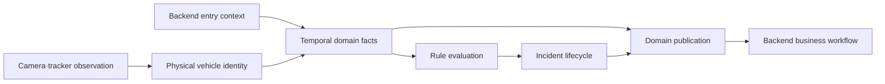

# Jetson 도메인 목적 및 출력 계약

> 상태: Draft · 관련 이슈: S15P11E202-461 · 범위: Jetson target domain contract · 비범위: 구현 상세, 테스트 계획, 배포 계획

이 문서는 Jetson 도메인이 존재하는 이유와 Jetson이 외부에 확정해 전달해야 하는 사실을 정의한다. 각 scope 내부 상태는 [Jetson Scope 수명주기 계약](./02-scope-lifecycle-contract.md), scope 사이의 영향은 [Jetson Scope 전파 및 종료 계약](./03-scope-propagation-contract.md)에서 다룬다.

## 1. Jetson 도메인의 목적

Jetson 도메인은 차량 상태를 많이 저장하기 위해 존재하지 않는다.

> Jetson 도메인은 카메라·tracker·입차 문맥에서 얻은 불완전한 관측을 시간에 걸쳐 해석하여, Backend가 업무를 수행할 수 있는 안정적이고 설명 가능하며 멱등적인 도메인 전이로 변환하기 위해 존재한다.

한 frame의 bbox나 tracker ID는 관측 결과일 뿐 다음 사실을 직접 증명하지 못한다.

- 직전 frame의 차량과 지금 차량이 같은 물리 차량인지
- 차량이 구역을 스쳐 지나가는지 실제로 방문 중인지
- 잠시 정지했는지 주차가 완료됐는지
- 차량이 한 frame 보이지 않는지 실제로 떠났는지
- 위반 조건이 처음 성립했는지 이미 보고된 사건이 계속되는지
- 차량이 움직인 뒤 위반 원인이 해소됐는지
- 카메라 장애로 모르는 것인지 물리 상태가 종료된 것인지

따라서 Jetson이 유지해야 하는 것은 하나의 거대한 `VehicleState`가 아니다. 동일성, 공간 방문, 이동·주차, 자격 문맥, 차량 간 관계, 사건, 전달 상태는 서로 다른 근거와 수명을 가진 독립적인 상태축이다.

## 2. 관측에서 업무 가능한 사실까지

Jetson의 판단은 다음 층을 따른다.



| 층 | 주요 질문 | 결과의 의미 |
|---|---|---|
| 관측 | 이번 frame에서 무엇이 보였는가? | 탐지·추적 신호이며 도메인 최종 사실이 아님 |
| 동일성 | 여러 track segment가 같은 차량인가? | Jetson 내부의 물리 차량 연속성 |
| 시간적 사실 | 어디에 얼마나 있었고, 얼마나 정지했는가? | `ZoneVisit`, `ParkingEpisode`, 공간 관계 |
| 규칙 평가 | 현재 규칙 조건이 성립하는가? | 상태 없는 `MATCHED / NOT_MATCHED / UNKNOWN` 판정 |
| 사건 lifecycle | 같은 사건인가, 새 사건인가, 해소됐는가? | `Incident`의 후보·OPEN·RESOLVE |
| 외부 전달 | 어떤 전이를 Backend에 공개했는가? | immutable publication과 전달 상태 |
| Backend 업무 | 누구에게 요청하고 어떻게 처리할 것인가? | 사건 처리·이동 요청·알림·관리자 판단 |

Jetson이 `OPEN`한 사건은 edge 규칙이 확정 조건을 충족했다는 뜻이다. 법적 판단이나 관리자 최종 확정이라는 뜻은 아니다.

## 3. 왜 시간적 상태가 필요한가

| 알고 싶은 사실 | 필요한 상태 | 단일 frame으로 부족한 이유 |
|---|---|---|
| 같은 차량인가 | `TrackSegment`, `PhysicalVehicle` | tracker ID는 가림·재탐지·재시작으로 바뀔 수 있음 |
| 어느 주차 세션의 차량인가 | `EntryMatchAttempt`, `ContextBinding`, `ParkingSessionMirror` | 입차 문맥 도착과 카메라 관측 시점이 다르고 비동기 매칭이 필요함 |
| 구역을 방문 중인가 | `ZoneVisit` | 진입·이탈 임계값과 confirmation window가 필요함 |
| 주차가 완료됐는가 | `ParkingEpisode` | 정지 신호를 신뢰 가능한 시간 동안 누적해야 함 |
| 대표 주차 위치는 어디인가 | `ParkingAssignment` | bbox jitter와 다중 구역 겹침을 안정화해야 함 |
| 다른 차량을 막고 있는가 | `BlockingRelation` | 차량 한 대의 bbox가 아니라 가해·피해·출차 경로의 시간적 관계가 필요함 |
| 위반 사건이 시작·유지·해소됐는가 | `Incident` | 반복 frame을 하나의 사건으로 축약하고 후보·OPEN·RESOLVE를 구분해야 함 |
| 이동 요청 뒤 현장이 바뀌었는가 | `MoveVerificationAttempt` | 이동 감지 뒤에도 규칙 원인이 남아 있는지 재평가해야 함 |
| Backend가 전이를 적용했는가 | outbox·delivery state·correlation | 도메인 전이와 HTTP 성공 여부는 서로 다른 사실임 |

현재 시스템에서 이미 합의된 식별자의 정의와 수명, 생성 주체는 [식별자 수명 및 매핑 계약](../identifier-contract.md)을 따른다. 이 목표 설계가 새로 요구하는 식별자는 [Scope 수명주기 계약의 목표 식별자 확장](./02-scope-lifecycle-contract.md#목표-식별자-확장)에 별도로 표시한다.

## 4. 세 상태축 분리

모든 설계 판단은 domain state, observation state, delivery state를 구분한다.

### 4.1 Domain state

실제 도메인에서 무엇이 성립했는지를 표현한다.

예:

- `ZoneVisit.INSIDE`
- `ParkingEpisode.PARKED`
- `BlockingRelation.BLOCKING`
- `Incident.OPEN`

### 4.2 Observation state

현재 그 도메인 사실을 얼마나 신뢰 가능하게 관측할 수 있는지를 표현한다.

```text
OBSERVED
DEGRADED
UNKNOWN
```

`UNKNOWN`은 긍정도 부정도 확인할 수 없다는 뜻이다. `NOT_MATCHED`, `OUTSIDE`, `UNPARKED`, `RESOLVED`, `EXITED`로 번역하지 않는다.

### 4.3 Delivery state

공개하기로 확정한 전이가 Backend에 전달·적용됐는지를 표현한다.

예:

```text
PENDING
IN_FLIGHT
RETRY_WAIT
DELIVERED
DEAD_LETTER
```

HTTP 실패는 domain state를 되돌리지 않는다. 동일한 publication revision과 동일한 payload를 재전송한다.

### 4.4 세 축의 조합

다음 조합은 모두 유효하다.

```text
Incident.domain       = OPEN
Incident.observation  = UNKNOWN
OPEN delivery         = DELIVERED
```

```text
ParkingEpisode.domain      = PARKED
ParkingEpisode.observation = OBSERVED
PARKED delivery            = RETRY_WAIT
```

카메라 장애가 발생해도 이미 확정한 `OPEN`이나 `PARKED`는 유지된다. 반대로 Backend 전달에 성공했어도 새 관측이 불확실하면 관측 상태는 `UNKNOWN`일 수 있다.

## 5. 공통 출력 원칙

### 5.1 도메인 식별자와 전달 식별자를 구분한다

- scope ID는 도메인 동일성을 표현한다.
- `publicationRevision`은 같은 aggregate가 외부에 공개한 전이 순서를 표현한다.
- `Idempotency-Key`는 같은 publication의 네트워크 재전송을 식별한다.
- `deliveryAttempt`는 전송 시도 횟수일 뿐 도메인 revision이 아니다.

현재 합의된 값의 상세 체계는 [식별자 수명 및 매핑 계약](../identifier-contract.md)을 따르고, 목표 설계에서 추가되는 값은 [목표 식별자 확장](./02-scope-lifecycle-contract.md#목표-식별자-확장)을 따른다.

### 5.2 UNKNOWN 시간은 확정 시간에 합산하지 않는다

정지 시간, 구역 진입·이탈 confirmation, 위반 confirm·clear window는 신뢰 가능한 관측 시간만 누적한다. 카메라 장애나 프로세스 중단 시간을 wall-clock 차이로 보충하지 않는다.

### 5.3 후보 취소와 확정 사건 해소를 구분한다

- 외부에 공개되지 않은 후보가 사라지면 `CANCELED`이며 publication은 없다.
- 이미 공개한 Incident의 원인이 사라지면 동일 `incidentId`의 `RESOLVE`다.
- terminal scope를 다시 활성화하지 않는다. 신뢰 가능한 비성립 구간 뒤 다시 조건이 성립하면 새 scope와 새 사건이다.

### 5.4 이동은 사건 해소와 같지 않다

공통 해소 정의는 다음과 같다.

> 사건은 차량이 움직였다는 사실만으로 해소되지 않는다. 사건을 성립시킨 도메인 술어가 더 이상 성립하지 않는 것이 신뢰 가능하게 확인됐을 때 해소된다.

| 사건 | 주요 해소 조건 | 이동의 역할 |
|---|---|---|
| 전용구역 무자격 | 해당 구역 이탈 또는 자격 정보 정정 | 구역 이탈을 만들 수 있는 관측 증거 |
| EV 초과 점유 | 해당 EV 구역 이탈 | 같은 구역 안의 이동만으로는 해소되지 않음 |
| 불량 주차 | 재배치 후 규칙 불성립 또는 출차 | 재배치 시작 신호이며 규칙 재평가가 필요함 |
| 이중주차 | 차단 관계 해소 또는 관련 session 종료 | 움직여도 계속 막고 있으면 사건 유지 |
| 통행로 방해 | 통행로 침범 관계 해소 또는 출차 | 같은 통행로 안의 이동이면 사건 유지 가능 |

### 5.5 재시작은 새 도메인 사실이 아니다

재시작 직후 원칙은 다음과 같다.

```text
durable domain state = 복구
observation state    = UNKNOWN
delivery state       = 복구
TrackSegment         = 새로 생성
```

복구한 OPEN Incident를 새 사건으로 만들지 않고, PARKED episode를 이동한 것으로 추정하지 않는다.

## 6. 출력 계약

### 6.1 입차 문맥 매칭 결과

논리적 결과:

```text
PENDING / MATCHED / EXPIRED / FAILED / CANCELED
```

| 항목 | 계약 |
|---|---|
| 의미하는 사실 | Backend가 만든 ParkingSession과 Jetson이 관측한 PhysicalVehicle의 연결 시도 및 그 결과 |
| 확정 주체 | `EntryMatchCoordinator` |
| 근거 상태 | 접수한 입차 문맥, ENTRY_EXIT 구역의 차량 후보, 관측 시각, 매칭 신뢰도, 기존 session 연결 여부 |
| 정상 종료 | 하나의 차량과 신뢰 가능하게 연결되면 `MATCHED`; 기한 만료는 `EXPIRED`; 복구 불가능한 계약 오류는 `FAILED`; session 선종료나 유효한 취소는 `CANCELED` |
| UNKNOWN 처리 | 기한 전에는 `PENDING`을 유지한다. 기한이 끝났다면 `NO_VEHICLE_MATCH`, `SOURCE_UNAVAILABLE`, `AMBIGUOUS_MATCH`를 구분한다. 정보가 없다는 이유로 임의 매칭하지 않는다. |
| 상위 scope 종료 | ParkingSession이 먼저 종료되면 진행 중인 attempt를 `CANCELED`로 끝낸다. 취소는 매칭 실패나 차량 부재 판정과 다르다. |
| 식별자·revision | `(sessionId, matchAttempt)`가 시도 동일성을 이룬다. 네트워크 `Idempotency-Key`는 별도다. |
| 재시작 복구 | 접수 성공을 응답하기 전에 attempt를 보존한다. 기한이 남았다면 재개하고 중단 구간을 차량 부재 근거로 사용하지 않는다. |

`EntryMatchAttempt.MATCHED`는 종료 결과이고, 성공 후 생성되는 `ContextBinding`은 별도의 활성 scope다. TrackSegment가 바뀌었다는 이유로 성공한 binding을 버리지 않는다.

### 6.2 PARKED

논리적 출력:

```text
ParkingEpisode → PARKED
```

| 항목 | 계약 |
|---|---|
| 의미하는 사실 | 동일한 물리 차량이 유의미한 이동 없이 설정된 시간 동안 신뢰 가능하게 정지하여 하나의 주차 구간이 확정됨 |
| 확정 주체 | `ParkingEpisodeTracker` |
| 근거 상태 | PhysicalVehicle, motion state, 누적 trusted stationary duration, ParkingAssignment, 가능한 경우 ContextBinding |
| 정상 종료 | 확정된 이동으로 같은 ParkingEpisode가 종료될 때 `UNPARKED` 전이를 만든다. |
| UNKNOWN 처리 | 확정 전 timer를 정지하고 UNKNOWN 시간을 누적하지 않는다. 이미 PARKED라면 PARKED를 유지하고 관측만 UNKNOWN으로 표시한다. |
| 상위 scope 종료 | ParkingSession EXIT가 확인되면 `SESSION_EXITED` 사유로 강제 종료한다. 이 경우 별도 UNPARKED를 만들지 않는다. |
| 식별자·revision | `parkingEpisodeId`가 주차 구간을 식별하고 공개 전이마다 `publicationRevision`을 단조 증가시킨다. |
| 재시작 복구 | episode, assignment, 누적 신뢰 정지 시간, 마지막 publication을 복구한다. 프로세스 중단 시간을 정지 시간에 합산하지 않는다. |

주차 사실과 publication 가능성은 구분한다. 세션 매칭 전에 주차가 확정됐다면 내부 ParkingEpisode는 PARKED로 유지하고, ContextBinding이 생길 때까지 외부 publication만 보류한다.

현재 목표 도메인 정책의 주차 확인 시간은 신뢰 가능한 연속 정지 `600초`다. 이 값은 ParkingEpisode가 시작될 때 적용한 versioned policy로 고정하며, `UNKNOWN` 시간과 process downtime은 600초에 포함하지 않는다.

### 6.3 UNPARKED

논리적 출력:

```text
ParkingEpisode → ENDED / MOVEMENT_CONFIRMED
```

| 항목 | 계약 |
|---|---|
| 의미하는 사실 | 이전에 PARKED로 확정됐던 주차 구간이 실제 차량 이동으로 끝남 |
| 확정 주체 | `ParkingEpisodeTracker` |
| 근거 상태 | 활성 PARKED episode와 신뢰 가능한 연속 이동 관측 |
| 정상 종료 | UNPARKED publication이 한 번 생성되면 해당 ParkingEpisode는 terminal이다. 재주차는 새 episode다. |
| UNKNOWN 처리 | TrackSegment 소실, 카메라 장애, 재식별 실패만으로 UNPARKED를 만들지 않는다. |
| 상위 scope 종료 | ParkingSession EXIT로 끝난 episode는 `SESSION_EXITED` 강제 종료다. Session EXIT가 점유 해제를 포함하므로 별도 UNPARKED는 발행하지 않는다. |
| 식별자·revision | PARKED와 동일한 `parkingEpisodeId`와 다음 `publicationRevision`을 사용한다. |
| 재시작 복구 | 이미 만든 ENDED publication이 미전송이면 같은 revision으로 재전송한다. PARKED 상태만 복구한 경우 이동을 추정하지 않는다. |

따라서 주차장 안 재배치는 `UNPARKED` 후 새 ParkingEpisode가 될 수 있지만, 출차는 Session EXIT로 표현한다.

### 6.4 Incident OPEN

논리적 출력:

```text
IncidentTransition.OPEN
```

| 항목 | 계약 |
|---|---|
| 의미하는 사실 | 특정 차량과 lifetime scope에 대해 규칙이 edge 확정 조건을 충족하여 Backend가 업무를 시작할 수 있음 |
| 확정 주체 | `RuleEvaluator`가 상태 없는 `IncidentSignal`을 만들고, `IncidentReducer`가 기존 사건과 축약하여 OPEN을 확정한다. |
| 근거 상태 | 규칙에 따라 ZoneVisit, ParkingEpisode, ContextBinding의 차량 자격, ParkingAssignment, BlockingRelation, trusted duration |
| 정상 종료 | 동일 사건을 성립시킨 규칙이 신뢰 가능하게 불성립하거나 lifetime scope가 확정적으로 종료될 때 RESOLVE한다. |
| UNKNOWN 처리 | 후보 confirmation을 정지한다. 이미 OPEN이면 OPEN을 유지한다. UNKNOWN을 `matched=false`로 변환하지 않는다. |
| 상위 scope 종료 | ZoneVisit·ParkingEpisode·BlockingRelation 등 지정된 lifetime scope 종료 또는 ParkingSession EXIT만 계약에 따라 해소를 전파한다. |
| 식별자·revision | OPEN 시 `incidentId`를 생성하고 첫 공개 revision을 만든다. 내부 동일성은 `ruleCode + lifetimeScope + subject + victim?`로 결정한다. |
| 재시작 복구 | OPEN Incident, IncidentKey, lifetime scope, 마지막 revision과 publication 상태를 복구한다. 새 incidentId로 다시 OPEN하지 않는다. |

`RuleEvaluator`는 Incident를 저장하거나 전이시키지 않는다.

```text
현재 도메인 사실
→ RuleEvaluator: MATCHED / NOT_MATCHED / UNKNOWN
→ IncidentSignal
→ IncidentReducer: CANDIDATE / OPEN / CLEAR_PENDING / RESOLVED
→ 필요한 publication만 생성
```

### 6.5 Incident RESOLVE

논리적 출력:

```text
IncidentTransition.RESOLVE
```

| 항목 | 계약 |
|---|---|
| 의미하는 사실 | 이미 OPEN된 동일 사건의 성립 원인이 더 이상 존재하지 않음 |
| 확정 주체 | `IncidentReducer` |
| 근거 상태 | 기존 OPEN Incident와 신뢰 가능한 `NOT_MATCHED`, lifetime scope의 확정 종료, Context 정정 또는 ParkingSession EXIT |
| 정상 종료 | RESOLVE 전이를 생성하고 Incident를 terminal로 만든다. 이후 같은 조건이 다시 성립하면 새 incidentId다. |
| UNKNOWN 처리 | 절대 RESOLVE하지 않는다. OPEN 또는 CLEAR_PENDING lifecycle을 유지하고 관측 상태만 UNKNOWN으로 둔다. |
| 상위 scope 종료 | 계약된 lifetime scope의 확정 종료는 직접 RESOLVE할 수 있다. Track 소실·source unavailable·process restart는 종료 근거가 아니다. |
| 식별자·revision | OPEN과 동일한 `incidentId`, 그다음 `publicationRevision`을 사용한다. |
| 재시작 복구 | terminal 상태, 최종 revision, 미완료 delivery를 복구한다. ACK되지 않은 RESOLVE는 같은 payload와 revision으로 재전송한다. |

대표적인 종료 사유는 다음과 같다.

```text
RULE_NO_LONGER_MATCHED
ZONE_VISIT_ENDED
PARKING_EPISODE_ENDED
BLOCKING_RELATION_ENDED
SESSION_EXITED
CONTEXT_CORRECTED
```

다음은 RESOLVE 사유가 아니라 observation 불확실성이다.

```text
TRACK_LOST
SOURCE_UNAVAILABLE
REIDENTIFICATION_UNCERTAIN
PROCESS_RESTARTED
```

Incident의 공식 외부 lifecycle은 OPEN/RESOLVE publication이 담당한다. Session EXIT는 session terminal 사실이자 Backend 누락 정리의 안전망이지만, Incident RESOLVE를 대체하지 않는다.

### 6.6 Evidence

논리적 출력:

```text
EvidenceArtifact upload
```

Evidence는 새로운 위반 사실이 아니라 특정 Incident 전이를 뒷받침하는 immutable artifact다.

| 항목 | 계약 |
|---|---|
| 의미하는 사실 | 특정 Incident publication을 뒷받침하는 이미지가 특정 시각에 생성됨 |
| 확정 주체 | Incident 정책이 증거 필요성을 결정하고 `EvidenceCoordinator`가 artifact lifecycle을 관리한다. |
| 근거 상태 | incidentId, incident publication revision, 원본 frame, capturedAt, imageType, checksum |
| 정상 종료 | Backend correlation인 eventId를 얻고 업로드 적용을 확인하면 전달이 완료된다. |
| UNKNOWN 처리 | 이미지 누락이나 손상만으로 이미 확정한 Incident를 취소하지 않는다. 증거가 확정 필수 조건인 규칙은 OPEN 이전 confirmable 정책에서 다룬다. |
| 상위 scope 종료 | Incident가 RESOLVED되거나 Session이 EXITED돼도 이미 생성한 증거 전달을 취소하지 않는다. |
| 식별자·revision | `evidenceId`, `incidentId`, 대상 publication revision과 checksum으로 상관관계를 유지한다. 업로드 재시도 횟수는 domain revision이 아니다. |
| 재시작 복구 | artifact metadata와 로컬 파일 전달 상태를 복구하고, eventId를 얻은 뒤 동일 artifact 업로드를 재개한다. |

Incident OPEN 적용 결과로 생성되는 Backend `eventId`는 증거 업로드의 전달 선행조건일 수 있지만 Incident lifecycle의 선행조건은 아니다.

Artifact가 영구 손실·손상되어 업로드할 수 없다면 `EvidenceArtifact.FAILED`와 실패 사유를 보존한다. Backend 또는 계약된 운영 권한자의 `EVIDENCE_UNAVAILABLE` 확인은 보존 blocker를 해제하는 별도 disposition일 뿐, 업로드 성공이나 Incident 취소로 기록하지 않는다.

### 6.7 EXIT

논리적 출력:

```text
ParkingSession → EXITED
```

| 항목 | 계약 |
|---|---|
| 의미하는 사실 | session에 연결된 차량이 출차 조건을 충족하여 해당 ParkingSession의 Jetson 측 현장 수명이 끝남 |
| 확정 주체 | `ExitDetector`와 `SessionLifecycleCoordinator` |
| 근거 상태 | ContextBinding, EXIT 구역의 확정 방문, 통과 방향과 출차 confirmation 조건 |
| 정상 종료 | EXIT publication이 생성되면 ParkingSessionMirror는 terminal이고 같은 session을 재활성화하지 않는다. |
| UNKNOWN 처리 | 출구 근처 TrackSegment 소실이나 카메라 장애만으로 EXIT를 만들지 않는다. Session은 reconciliation 대상인 ACTIVE 상태로 유지한다. |
| 상위 scope 종료 | Backend가 ParkingSession이 이미 종료됐음을 authoritative하게 확인하면 local mirror와 하위 scope를 강제 종료하되 Jetson EXIT를 새로 감지한 것처럼 중복 발행하지 않는다. |
| 식별자·revision | `sessionId`가 aggregate를 식별한다. Session당 EXIT는 한 번이며 publication revision과 Idempotency-Key를 구분한다. |
| 재시작 복구 | Session 상태와 미완료 EXIT publication을 복구한다. 이미 terminal인 session에서 늦은 PARKED나 Incident OPEN을 만들지 않는다. |

Session EXIT가 확정되면 ContextBinding, ZoneVisit, ParkingEpisode, BlockingRelation, Incident, MoveVerification에 계약된 종료를 전파한다. PhysicalVehicle 자체는 ParkingSession의 자식이 아니므로 session 종료만으로 retire하지 않는다.

### 6.8 MoveVerificationResult

논리적 결과:

```text
RESOLVED / STILL_ACTIVE / UNKNOWN
```

| 항목 | 계약 |
|---|---|
| 의미하는 사실 | Backend가 지정한 Incident를 요청 이후의 현장 관측으로 재확인한 결과 |
| 확정 주체 | `MoveVerificationCoordinator`; movement는 MotionTracker, 현재 rule match는 RuleEvaluator, Incident 상태는 IncidentReducer의 결과를 사용한다. |
| 근거 상태 | requestId, incidentId, verificationAttempt, 요청 이후의 trusted observation, movement evidence, 현재 rule match와 incident revision |
| 정상 종료 | 한 verification attempt에 대해 `RESOLVED`, `STILL_ACTIVE`, `UNKNOWN` 중 하나의 immutable 결과를 만든다. |
| UNKNOWN 처리 | 기한 안에 신뢰 가능한 현장 판정을 얻지 못하면 `UNKNOWN`을 명시적으로 반환한다. 이동 완료나 Incident RESOLVE로 번역하지 않는다. |
| 상위 scope 종료 | 대상 Incident가 이미 RESOLVED됐거나 ParkingSession EXIT가 확정되면 `RESOLVED`와 그 사유를 반환할 수 있다. Track 소실이나 camera unavailable은 `UNKNOWN`이다. |
| 식별자·revision | `(requestId, verificationAttempt)`가 결과 동일성이다. incidentId와 판단에 사용한 incident revision을 함께 전달한다. |
| 재시작 복구 | command, deadline, 대상 incident, attempt와 delivery를 복구한다. 중단 구간 뒤 충분한 새 관측을 얻지 못하면 `UNKNOWN`이다. |

`movementDetected`는 evidence다. 다음 결과가 가능하다.

```text
movementDetected = true
current rule match = MATCHED
verification result = STILL_ACTIVE
```

Backend의 `COMPLETED`, `RENOTIFIED`, `NEED_ADMIN`은 MoveVerificationResult를 받은 뒤 Backend가 결정하는 업무 상태다.

## 7. 출력과 scope의 대응

| 외부 사실 | 주요 lifetime scope | 공식 전이 |
|---|---|---|
| 입차 문맥 매칭 결과 | `EntryMatchAttempt` | `MATCHED / EXPIRED / FAILED / CANCELED` |
| 주차 완료 | `ParkingEpisode` | `PARKED` |
| 주차 해제 | `ParkingEpisode` | `ENDED / MOVEMENT_CONFIRMED` |
| 전용구역·EV 초과 점유 사건 | `ZoneVisit`을 lifetime scope로 갖는 `Incident` | `OPEN / RESOLVE` |
| 불량 주차 사건 | `ParkingEpisode`를 lifetime scope로 갖는 `Incident` | `OPEN / RESOLVE` |
| 이중주차 사건 | `BlockingRelation`을 lifetime scope로 갖는 `Incident` | `OPEN / RESOLVE` |
| 증거 이미지 | `EvidenceArtifact` | 업로드 완료 |
| 출차 | `ParkingSessionMirror` | `EXITED` |
| 이동 요청 재확인 | `MoveVerificationAttempt` | `RESOLVED / STILL_ACTIVE / UNKNOWN` |

`OutboxRecord`는 위 표의 도메인 사실이 아니다. 확정한 publication을 잃지 않고 전달하기 위한 delivery workflow다.

### 7.1 규칙별 scope와 확정 조건

각 규칙은 독립적으로 평가한다. 한 차량에 여러 규칙이 동시에 성립할 수 있으며, 단일 enum 우선순위로 하나를 숨기지 않는다.

| Rule code | lifetime scope | OPEN에 필요한 핵심 사실 | ParkingEpisode 필요 | 주요 해소 |
|---|---|---|---|---|
| `DISABLED_ZONE_UNAUTHORIZED` | ZoneVisit | 장애인 구역 `INSIDE` + `isDisabledVehicle=false` | 아니요 | visit 이탈·Session 종료·자격 정정 |
| `EV_ZONE_UNAUTHORIZED` | ZoneVisit | EV 구역 `INSIDE` + `isElectric=false` | 아니요 | visit 이탈·Session 종료·자격 정정 |
| `EV_OVERSTAY` | ZoneVisit | EV 구역 trusted visit duration이 versioned `allowedMinutes`를 초과 | 아니요 | visit 이탈·Session 종료 |
| `BAD_PARKING` | ParkingEpisode | `PARKED` + 안정된 assignment·footprint에서 불량 주차 술어 성립 | 예 | 재배치 후 술어 불성립·episode 종료·Session 종료 |
| `OUT_OF_ZONE` | ParkingEpisode | `PARKED` + 어떤 주차면에도 유효하게 배정되지 않음 | 예 | 유효 배정·episode 종료·Session 종료 |
| `AISLE_BLOCK` | ParkingEpisode | `PARKED` + 통행로 침범 술어 성립 | 예 | 침범 해소·episode 종료·Session 종료 |
| `DOUBLE_PARKING` | BlockingRelation | `BLOCKING` + 확인 가능한 subject·victim·egress corridor | subject·victim의 PARKED episode는 relation 생성 근거지만 lifetime은 relation | 차단 관계 해소·관련 Session 종료 |

차량 자격이 `UNKNOWN`이면 무자격이 아니다. Restricted-zone 규칙은 `IncidentSignal.UNKNOWN`으로 남기고 자격 문맥을 기다린다. `allowedMinutes`나 egress corridor처럼 규칙에 필수인 정책이 없을 때도 자동 확정하지 않는다.

`STOP_PENDING` 동안 불량 주차 후보를 계산할 수는 있지만 `confirmable=false`다. 신뢰 가능한 정지 600초를 채워 PARKED가 되기 전에는 Backend publication을 만들지 않는다. 반면 전용구역 진입과 EV 초과 점유는 ParkingEpisode를 기다리지 않는다.

## 8. Jetson과 Backend의 책임 경계

### 8.1 권한

| 사실 또는 상태 | 권한 주체 | 경계 |
|---|---|---|
| Camera availability, TrackSegment | Jetson | Backend에 물리 상태로 보고하지 않음 |
| PhysicalVehicle 동일성 | Jetson | Backend가 tracker ID를 session ID처럼 사용하거나 병합하지 않음 |
| ZoneVisit, ParkingEpisode, BlockingRelation | Jetson | Backend는 공개된 결과를 mirror할 수 있으나 현장 관측을 재구성하지 않음 |
| Edge Incident lifecycle | Jetson | Backend는 적용한 revision과 업무 correlation을 보존 |
| ParkingSession 생성과 authoritative 종료 | Backend | Jetson은 mirror하며 Backend 종료 확인을 하위 scope 강제 종료 근거로 사용할 수 있음 |
| vehicleId와 차량 자격 | Backend | Jetson은 ContextBinding의 versioned context로 사용하고 정정 시 규칙 재평가 |
| Backend event 업무 상태 | Backend | 관리자 처리 상태가 Jetson의 현재 물리 판정을 덮어쓰지 않음 |
| MoveRequest·알림·재알림 | Backend | Jetson은 지정된 Incident의 현장 상태만 재확인 |
| MoveVerificationResult | Jetson | Backend가 결과를 바탕으로 업무 action을 결정 |
| publication 적용 여부·correlation | Backend | Jetson delivery·reconciliation에서 확인 |

### 8.2 서로 다른 `RESOLVED`

다음 상태는 같지 않다.

```text
Jetson Incident.RESOLVED
Backend eventStatus.RESOLVED
Backend MoveRequest.COMPLETED
```

- Jetson Incident RESOLVE는 현장 규칙의 원인이 불성립했다는 edge 사실이다.
- Backend eventStatus는 관리자 처리와 서비스 업무 상태다.
- MoveRequest 상태는 사용자 이동 요청 workflow다.

관리자가 Backend 사건을 닫았다는 이유만으로 Jetson의 OPEN Incident를 RESOLVE하지 않는다. 반대로 Jetson이 Incident를 RESOLVE하면 Backend는 해당 edge 전이를 자신의 업무 규칙에 따라 적용한다.

### 8.3 사건 종료 권한의 단일 경로

외부 계약에서 각 출력의 역할을 다음처럼 구분한다.

- Incident transition은 Incident OPEN/RESOLVE publication이 공식 경로다.
- Session EXIT는 ParkingSession terminal 사실이며 관련 상태 누락 정리의 안전망이다.
- MoveVerificationResult는 요청받은 Incident의 현재 현장 판정 결과다. Incident lifecycle을 대신 갱신하는 별도 경로가 아니다.

Backend는 같은 Incident의 중복·순서를 `incidentId + publicationRevision`으로 통제하고, 동일 revision의 payload 동일성을 확인해야 한다.

## 9. Jetson의 비책임

Jetson 도메인은 다음을 결정하지 않는다.

- 사건의 법적·관리자 최종 확정
- 사용자에게 알릴지와 어떤 채널로 알릴지
- 이동 요청의 재알림 횟수와 관리자 전환 정책
- Backend event의 업무 상태 우선순위
- 차량 등록 정보나 자격의 원천 데이터 변경
- HTTP 성공 여부를 근거로 domain state를 되돌리는 것
- 카메라 장애·tracker ID 소실을 물리적 출차나 위반 해소로 추정하는 것

Jetson의 책임은 신뢰 가능한 현장 사실과 그 근거, 동일성, revision을 일관되게 제공하는 데까지다.

## 10. 이 문서가 고정하는 결정

1. Jetson은 관측을 시간적 도메인 사실과 publication으로 변환하는 edge 판단 시스템이다.
2. domain·observation·delivery state는 독립적인 축이다.
3. `UNKNOWN`은 부정 사실이나 lifecycle 종료가 아니다.
4. ParkingEpisode의 PARKED/ENDED에는 안정적인 episode identity와 publication revision이 필요하다.
5. 주차장 내부 재배치는 UNPARKED, 출차는 Session EXIT로 구분한다.
6. Incident OPEN/RESOLVE의 유일한 상태 소유자는 IncidentReducer다.
7. Incident는 이동 자체가 아니라 성립 원인의 불성립이 확인됐을 때 해소한다.
8. 이중주차의 lifetime scope는 단일 ParkingEpisode가 아니라 BlockingRelation이다.
9. MoveVerificationResult는 `RESOLVED / STILL_ACTIVE / UNKNOWN`을 표현하고 movement 여부는 evidence로 둔다.
10. Incident RESOLVE, Session EXIT, MoveVerificationResult의 외부 역할을 서로 겹치지 않게 유지한다.
11. 재시작은 기존 도메인 사실을 새로 만들거나 종료시키지 않는다.
12. 식별자, publication revision, Idempotency-Key, delivery attempt를 서로 다른 개념으로 유지한다.

각 결정의 구체적인 scope 상태와 전파 방식은 다음 문서에서 이어서 정의한다.

- [Jetson Scope 수명주기 계약](./02-scope-lifecycle-contract.md)
- [Jetson Scope 전파 및 종료 계약](./03-scope-propagation-contract.md)
- [Jetson 상태 보존 및 Retention 계약](./04-durable-state-and-retention-contract.md)
- [Jetson–Backend 상태 Reconciliation 계약](./05-backend-reconciliation-contract.md)
