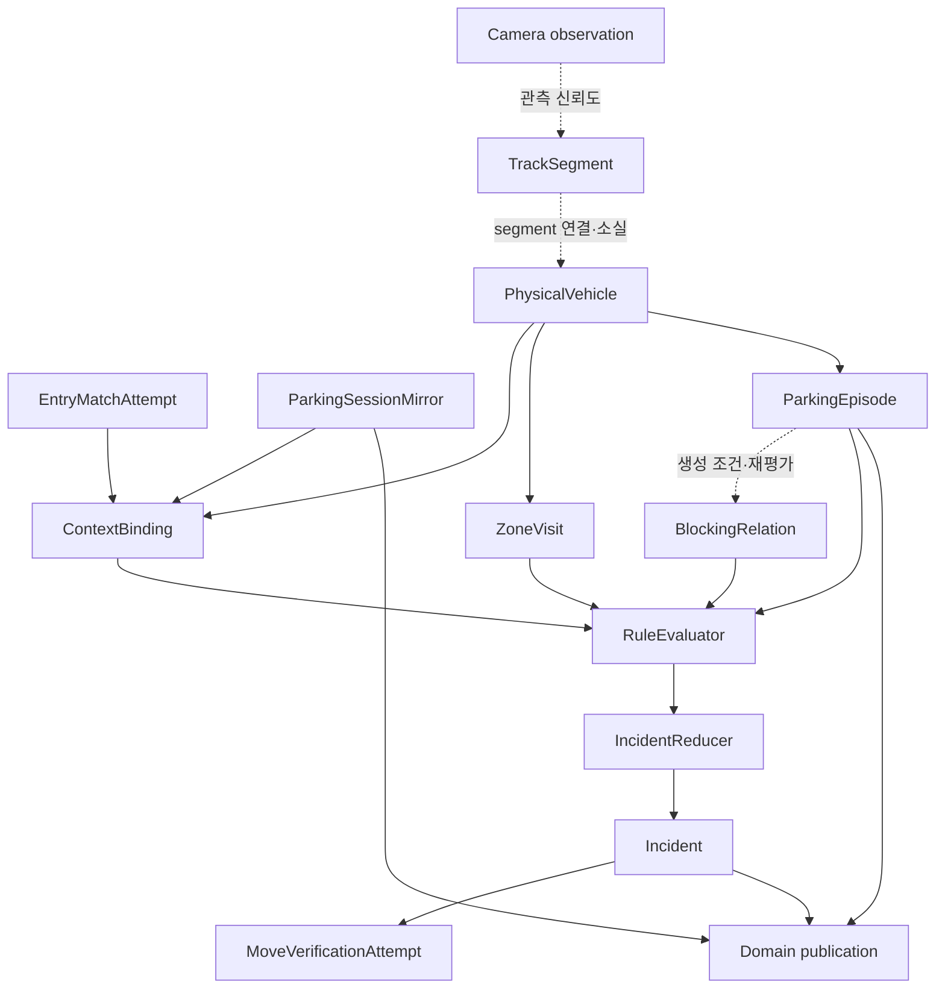

# Jetson Scope 전파 및 종료 계약

> 상태: Draft · 관련 이슈: S15P11E202-461 · 범위: Jetson target domain contract · 비범위: 구현 상세, 테스트 계획, 배포 계획

이 문서는 한 scope의 관측·전이가 다른 scope에 어떤 영향을 주는지 고정한다. 각 scope 내부 상태와 공통 lifecycle 의미는 [Jetson Scope 수명주기 계약](./02-scope-lifecycle-contract.md)을 따른다.

## 핵심 원칙

한 scope가 다른 scope의 입력이라는 사실만으로 종료를 자동 전파하지 않는다. 관계마다 다음 중 어떤 동작이 필요한지 명시한다.

| 동작 | 의미 |
|---|---|
| `KEEP` | 확정된 lifecycle과 domain state를 유지한다. |
| `OBSERVATION_UNKNOWN` | lifecycle은 유지하고 관측 상태만 `UNKNOWN`으로 바꾼다. |
| `REEVALUATE` | 최신 도메인 사실을 사용해 규칙이나 공간 관계를 다시 평가한다. |
| `CANCEL` | 아직 공개되지 않은 `PROVISIONAL` scope를 외부 전이 없이 취소한다. |
| `END_NORMAL` | scope 자체의 정상 종료 조건이 확인됐다. |
| `END_FORCED` | authoritative 상위 scope나 정정에 의해 종료한다. |
| `PUBLISH` | 외부에 알릴 domain transition을 생성한다. |

다음 세 등식은 성립하지 않는다.

```text
관측 소실 = 물리 상태 종료
차량 이동 = Incident 해소
의존 관계 = lifecycle 종속 관계
```

## 전체 관계



실선도 모두 자동 cascade를 뜻하지 않는다. 종료가 전파되는 관계는 아래 행렬에서만 정한다.

## 관측과 추적

| 발생한 변화 | 직접 영향 | 하위 scope 처리 | 외부 출력 |
|---|---|---|---|
| Camera `UNAVAILABLE` | 관측 기반 scope의 신뢰도 상실 | lifecycle 유지, 관측을 `UNKNOWN`, 시간 누적 정지 | 없음 |
| Camera 회복 | 즉시 정상으로 간주하지 않음 | `DEGRADED`에서 scope별 재확인 후 `OBSERVED` | 실제 domain transition이 있을 때만 |
| TrackSegment 종료, 다른 segment 존재 | PhysicalVehicle 동일성 유지 | ZoneVisit·ParkingEpisode에 영향 없음 | 없음 |
| TrackSegment 종료, 대체 segment 없음 | PhysicalVehicle 재식별 유예 | 하위 lifecycle 유지, 관측만 `DEGRADED` 또는 `UNKNOWN` | 없음 |
| 동일 PhysicalVehicle 재식별 성공 | 기존 identity의 관측 복구 | 기존 scope를 새 신뢰 관측부터 재개 | 실제 전이가 있을 때만 |
| 재식별 보존 기한 만료, 공개 사실 없음 | 로컬 identity hypothesis 정리 가능 | 공개되지 않은 후보만 만료 가능 | 없음 |
| 재식별 보존 기한 만료, session·공개 사실 존재 | durable suspended 상태로 이동 | `ACTIVE + UNKNOWN` 유지 | 없음 |
| 프로세스 재시작 | 기존 TrackSegment는 이어 붙이지 않음 | durable lifecycle 복구, 관측은 `UNKNOWN` | pending publication만 재개 |

Camera unavailable이나 stale prune은 `ZoneVisit.OUTSIDE`, `ParkingEpisode.ENDED`, `Incident.RESOLVED`, `ParkingSession.EXITED`의 근거가 될 수 없다. `TrackingBatch.source_available=false`인 구간도 같은 원칙을 따른다.

재관측 후에는 중단 시간을 wall-clock 차이로 소급하지 않는다. 확인 타이머는 새 신뢰 관측부터 다시 진행한다.

## 입차 매칭과 ContextBinding

| 발생한 변화 | EntryMatchAttempt | ContextBinding | Parking·Incident 영향 |
|---|---|---|---|
| 입차 문맥 접수 | `PENDING` 생성 | 아직 없음 | 차량 상태를 session에 귀속하지 않음 |
| 매칭 성공 | `MATCHED`로 정상 종료 | 새 binding 생성 | 보류 중인 session-scoped publication을 전송할 수 있음 |
| 매칭 기한 만료 | `EXPIRED` | 생성하지 않음 | 자격을 무자격으로 추정하지 않음 |
| Camera unavailable 중 만료 | 사유를 `SOURCE_UNAVAILABLE`로 구분 | 생성하지 않음 | retryable 결과로 유지 가능 |
| 동일 차량 자격 정정 | 새 attempt 없음 | context version 갱신 | 관련 규칙을 `REEVALUATE` |
| 다른 PhysicalVehicle로 재연결 | 기존 binding 강제 종료 | 새 binding 생성 | 이전 차량 상태 자동 상속 금지 |
| ParkingSession 종료 | 진행 중 attempt 취소 | binding 강제 종료 | Session EXIT 전파 적용 |

차량 자격 정정과 물리 차량 연결 정정은 다르다. `isElectric`, `isDisabledVehicle` 같은 자격 변경은 동일 binding의 version을 올리고 규칙을 재평가한다. `physicalVehicleId`를 바꾸는 정정은 이전 binding을 끝내고 새 binding을 생성하며, 위치가 가깝다는 이유만으로 ParkingEpisode나 Incident를 옮기지 않는다.

## ZoneVisit

### 활성 방문

```text
ZoneVisit ENTERING·INSIDE·EXITING
→ Pipeline
→ RuleEvaluator가 현재 규칙 성립 여부 평가
→ IncidentSignal
→ IncidentReducer가 사건 상태로 축약
```

전용구역 무자격과 EV 초과 점유처럼 방문 자체를 수명 범위로 삼는 규칙은 활성 ZoneVisit을 기준으로 평가한다.

### 종료된 방문

```text
ZoneVisit 종료 확정
→ Pipeline이 zoneVisitId와 종료 사유 전달
→ IncidentReducer가 lifetime scope index 조회
→ 후보는 취소
→ OPEN 사건은 RESOLVE
```

종료 경로에서는 현재 ZoneRegistry를 다시 조회하거나 `ruleCode`를 재구성하지 않는다. OPEN 당시 Incident가 보존한 lifetime scope와 rule 정보를 사용한다.

| ZoneVisit 변화 | Incident 처리 | 외부 출력 |
|---|---|---|
| `ENTERING` 생성 | 필요하면 내부 후보 생성 | 없음 |
| `ENTERING` 후보 취소 | 관련 후보 취소 | 없음 |
| `INSIDE` 확정 | 방문 기반 규칙 평가 | 조건 충족 시 Incident OPEN |
| `INSIDE` 유지 | 현재 규칙 재평가 | 새 전이가 있을 때만 |
| 신뢰 가능한 구역 이탈 | 해당 visit 기반 Incident 종료 | Incident RESOLVE |
| 관측 `UNKNOWN` | 후보·OPEN 상태 유지, timer 정지 | 없음 |
| ParkingSession EXIT | 후보 취소, OPEN 사건 강제 종료 | Incident RESOLVE |
| 권한 있는 Zone definition 교체·삭제 | 기존 definition의 visit 강제 종료 | 기존 사건 RESOLVE, 필요하면 새 visit에서 새 OPEN |
| ZoneRegistry 조회 실패·설정 미로딩 | visit lifecycle 유지, observation `UNKNOWN` | 없음 |

권한 있는 versioned 설정 전이로 Zone definition이 바뀌면 기존 visit을 새 정의 아래에서 계속 사용하지 않는다. 기존 `zoneDefinitionVersion`의 방문을 끝내고, 차량이 새 정의에서도 존재하면 새 `zoneVisitId`를 생성한다. 현재 registry에서 조회되지 않는다는 사실만으로 삭제를 추정하지 않는다.

## ParkingEpisode

| ParkingEpisode 변화 | Assignment | 규칙·관계 | Incident | 외부 출력 |
|---|---|---|---|---|
| `STOP_PENDING` | 후보 계산 가능 | 규칙은 `confirmable=false` | 후보만 가능 | 없음 |
| 확정 전 이동 | 후보 폐기 | 평가 종료 | 후보 취소 | 없음 |
| `PARKED` 확정 | 대표 assignment 확정 | 불량 주차 평가, 차단 관계 탐색 | OPEN 가능 | PARKED, Incident OPEN |
| `PARKED` 유지 | jitter에 안정적으로 유지 | 현재 규칙·관계 재평가 | 유지·해소·새 사건 | 새 전이가 있을 때만 |
| 이동 확정 | assignment 종료 | 규칙과 BlockingRelation 재평가 | episode-scoped 사건 RESOLVE | UNPARKED |
| 관측 `UNKNOWN` | 기존 assignment 보존 | 평가·timer 보류 | OPEN 유지 | 없음 |
| ParkingSession EXIT | active assignment 참조 해제, 마지막 값을 episode terminal snapshot에 고정 | 관계 강제 정리 | 사건 강제 RESOLVE | UNPARKED는 보내지 않음 |

주차장 안에서 재배치하면 `UNPARKED`를 발행한다. 출차로 Session이 종료되면 별도 `UNPARKED`를 발행하지 않고 Session EXIT가 점유 해제의 상위 사실이 된다.

## BlockingRelation

ParkingEpisode 종료는 BlockingRelation 종료가 아니라 재평가 trigger다.

```text
ParkingEpisode 이동 확정
→ BlockingRelation geometry 재평가
→ 계속 막고 있으면 BLOCKING 유지
→ clear confirmation을 통과하면 종료
```

| 발생한 변화 | BlockingRelation | DOUBLE_PARKING Incident |
|---|---|---|
| 두 PARKED 차량의 차단 후보 확인 | `CANDIDATE` | 후보 가능 |
| 차단 확인 조건 충족 | `BLOCKING` | OPEN 가능 |
| 가해 차량 이동, 여전히 차단 | `BLOCKING` 유지 | OPEN 유지 |
| clear 후보 | `CLEAR_PENDING` | OPEN 유지 |
| clear 확인 조건 충족 | 정상 종료 | RESOLVE |
| 어느 한 차량 관측 UNKNOWN | lifecycle 유지, 관측 UNKNOWN | OPEN 유지 |
| subject·victim Session EXIT | 강제 종료 | RESOLVE |
| egress corridor 제거·정정 | 강제 종료 또는 새 relation 생성 | 기존 사건 RESOLVE |

차단 관계가 한 번 신뢰 가능하게 해소된 뒤 다시 성립하면 새 `blockingRelationId`와 새 Incident를 생성한다.

## Incident

RuleEvaluator는 현재 규칙 결과만 만든다. 결과는 `MATCHED`, `NOT_MATCHED`, `UNKNOWN`의 삼상태여야 한다. `UNKNOWN`을 `NOT_MATCHED`로 번역하지 않는다.

| 입력 | CANDIDATE | OPEN·CLEAR_PENDING | 외부 출력 |
|---|---|---|---|
| `MATCHED`, 아직 확정 불가 | 생성·유지 | OPEN이면 유지 | 없음 |
| `MATCHED`, 확정 가능 | OPEN 전환 | OPEN 유지 | OPEN 1회 |
| 신뢰 가능한 `NOT_MATCHED` | 취소 | CLEAR_PENDING 후 RESOLVE 가능 | OPEN됐던 사건만 RESOLVE |
| `UNKNOWN` | 유지, timer 정지 | 유지, timer 정지 | 없음 |
| lifetime scope 정상 종료 | 취소 | 정상 RESOLVE | RESOLVE |
| ParkingSession EXIT | 취소 | 강제 RESOLVE | RESOLVE |
| Backend 전송 실패 | 상태 유지 | 상태 유지 | 같은 revision 재시도 |

RESOLVED Incident는 다시 OPEN하지 않는다. 동일 규칙이 신뢰 가능한 비위반 구간 뒤 다시 성립하면 새 `incidentId`를 생성한다. 일시적 UNKNOWN 동안에는 기존 Incident를 유지하므로 불필요한 새 사건이 생기지 않는다.

## ParkingSession EXIT

ParkingSession은 Jetson 도메인에서 가장 강한 authoritative terminal scope다.

| 대상 | EXIT 처리 | 외부 의미 |
|---|---|---|
| EntryMatchAttempt | 진행 중이면 `CANCELED / SESSION_EXITED`로 종료 | terminal 매칭 결과 `CANCELED` |
| ContextBinding | 강제 종료 | 없음 |
| PhysicalVehicle | 자동 종료하지 않음 | binding만 해제 |
| ZoneVisit | 강제 종료 | 방문 기반 Incident 정리 |
| ParkingEpisode | 강제 종료 | 별도 UNPARKED 없음 |
| ParkingAssignment | episode의 active 참조를 해제하고 terminal episode snapshot에 마지막 값을 고정 | 없음 |
| BlockingRelation | 강제 종료 | DOUBLE_PARKING 정리 |
| Incident | `SESSION_EXITED`로 RESOLVE | Incident RESOLVE |
| MoveVerificationAttempt | `RESOLVED/SESSION_EXITED` 결과 | Verification result |
| EvidenceArtifact | 취소하지 않음 | 기존 업로드 계속 |
| ParkingSessionMirror | Jetson 출차 확인이면 정상 종료, Backend `CLOSED` 적용이면 authoritative 강제 종료 | Jetson 출차 확인 때만 EXIT; Backend 선종료에는 새 edge EXIT 없음 |

Jetson 내부에서는 하위 상태를 모두 명시적으로 종료한다. Incident의 공식 외부 lifecycle은 Incident RESOLVE가 담당하고, Session EXIT는 Session terminal 사실과 Backend 누락 정리의 안전망이다.

## MoveVerification

MoveVerification은 이동 자체가 아니라 요청받은 Incident의 현재 성립 여부를 확인한다.

| 확인 결과 | 의미 |
|---|---|
| `RESOLVED` | 대상 Incident 원인이 불성립하거나 Session이 종료됨 |
| `STILL_ACTIVE` | 신뢰 가능한 재평가에서 규칙이 계속 성립함 |
| `UNKNOWN` | 기한 안에 신뢰 가능한 현장 판단을 얻지 못함 |

```text
movementDetected=true
+ 규칙이 계속 성립
→ STILL_ACTIVE
```

Camera unavailable, TrackSegment 소실, 재시작 gap은 `UNKNOWN` 근거이지 `RESOLVED` 근거가 아니다. Backend의 `COMPLETED`, `RENOTIFIED`, `NEED_ADMIN`은 이 결과를 받은 뒤 Backend가 결정하는 업무 상태다.

## Outbox와 Evidence

도메인 전송 실패는 domain lifecycle을 되돌리지 않는다. 동일 publication revision과 동일 payload를 재전송한다.

| 발생한 변화 | Domain scope | Delivery 처리 |
|---|---|---|
| 공개 전이 생성 | lifecycle 전이 확정 | 동일 전이를 durable outbox에 기록 |
| HTTP 일시 실패 | 변경 없음 | retry 대기 |
| HTTP ACK | 변경 없음 | 전달 완료와 Backend correlation 기록 |
| 프로세스 재시작 | durable state 복구 | 미완료 전송 재개 |
| DEAD_LETTER | 변경 없음 | 자동 삭제·domain rollback 금지 |
| Incident RESOLVE | Incident terminal | 기존 OPEN evidence 업로드 계속 |
| Session EXIT | Session terminal | 기존 evidence 업로드 계속 |

Evidence upload가 Backend `eventId`를 필요로 한다면 Incident OPEN 적용 확인 뒤 진행한다. 이는 전송 dependency이지 Incident lifecycle dependency가 아니다.

## 재시작 전파

재시작 직후 상태는 다음과 같다.

```text
durable domain lifecycle = 복구
observation state = UNKNOWN
delivery state = 복구
TrackSegment = 새로 생성
```

복구된 OPEN Incident를 새 Incident로 만들지 않는다. 복구된 PARKED episode를 이동한 것으로 보지 않는다. 첫 신뢰 관측을 얻기 전까지 규칙 해소와 시간 누적을 보류한다.

## 전파 불변조건

1. 관측 상태 변경은 lifecycle 종료를 직접 만들지 않는다.
2. TrackSegment 종료는 PhysicalVehicle의 물리적 종료가 아니다.
3. ZoneVisit 종료는 신뢰 가능한 이탈 또는 authoritative 상위 종료에서만 발생한다.
4. ParkingEpisode 종료는 이동 확인 또는 authoritative 상위 종료에서만 발생한다.
5. BlockingRelation은 실제 clear 확인 전까지 유지한다.
6. Incident는 `NOT_MATCHED`, lifetime scope 종료, authoritative correction으로만 해소한다.
7. 후보 취소는 외부 RESOLVE를 만들지 않는다.
8. 참조 관계만으로 자동 cascade하지 않고, 이 문서의 행렬에 명시된 전이만 전파한다. Session EXIT는 가장 넓은 강제 종료 전파다.
9. 전송 실패는 domain state를 변경하지 않는다.
10. 동일 terminal scope를 재활성화하지 않는다.
