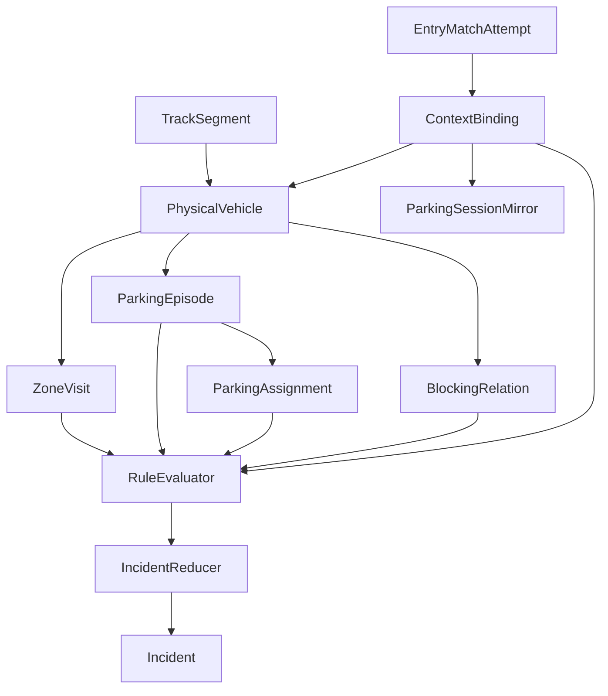

# Jetson Scope 전파 및 종료 계약

> 상태: Draft · 관련 이슈: S15P11E202-461 · 책임: scope 사이의 재평가와 종료 전파

이 문서는 한 scope의 변화가 다른 scope에 미치는 영향만 정의한다. 상태 자체의 의미는 [Scope 수명주기 계약](./02-scope-lifecycle-contract.md)을 따른다.

## 1. 전파 원칙

1. 참조 관계만으로 종료를 cascade하지 않는다.
2. observation 변화는 기본적으로 재평가 또는 timer 정지만 일으킨다.
3. `REEVALUATE`는 새 관측으로 규칙을 다시 계산하라는 trigger이며 domain state가 아니다.
4. ParkingEpisode의 MOVEMENT_CONFIRMED 종료와 movement는 Incident를 직접 RESOLVE하지 않는다.
5. 실제 Session EXIT만 session-scoped 물리 사실의 terminal 전파를 조정한다.
6. Backend의 행정 종료는 실제 EXIT와 구분한다.
7. 공개 전이를 수반하는 다중 변경은 `04`의 한 consistency boundary로 commit한다.

## 2. 관계 개요



화살표는 입력 또는 조회 관계다. 자동 lifecycle 종속성을 뜻하지 않는다.

## 3. 관측과 tracking

| 발생한 변화 | 직접 영향 | 재평가 | 금지되는 추론 |
|---|---|---|---|
| 한 TrackSegment 종료 | EntityResolver가 segment 연결 해제 | 재식별 후보 탐색 | PhysicalVehicle·ZoneVisit·ParkingEpisode·Incident 종료 |
| tracker reset | 모든 기존 segment 종료 | 새 segment를 PhysicalVehicle에 재연결 | 실제 출차·UNPARKED·RESOLVE |
| camera/pipeline unavailable | 관측 기반 scope를 DEGRADED 또는 UNKNOWN | timer 정지, health 갱신 | 빈 frame을 차량 부재로 해석 |
| 장기 UNKNOWN | operational health 경고 | 복구 시 다시 관측 | 시간만으로 terminal 전이 |
| 정상 전체 관측에서 `NOT_PRESENT_CONFIRMED` | `PHYSICAL_VEHICLE_LEFT` 처리 시작 | session 유무와 관계없이 child·Incident 정리 뒤 PhysicalVehicle RETIRED 조건 평가 | 단순 tracker timeout과 동일시 |
| process restart | TrackSegment 폐기, durable state 복원 | 첫 정상 관측부터 재평가 | downtime을 trusted duration에 합산 |

camera 한 대가 전체 모형을 관측한다는 전제가 성립할 때만 `NOT_PRESENT_CONFIRMED`를 사용할 수 있다. 부분 frame, camera unavailable과 calibration 오류 중에는 사용할 수 없다.

NOT_PRESENT_CONFIRMED된 차량에 active ContextBinding 또는 행정 종료 뒤 보존한 session–vehicle correlation이 있으면 physicalPresenceState를 `EXITED / JETSON_EXIT_CONFIRMED / FULL_AREA_ABSENCE`로 전환하고 SessionExit을 만들 수 있다. 어느 session과도 연결되지 않아도 `PHYSICAL_VEHICLE_LEFT`로 local child와 Incident를 종료할 수 있다.

## 4. 입차 문맥과 ContextBinding

Access decision과 EntryMatchOutcome은 독립적으로 전파한다.

| 변화 | EntryMatchAttempt | ContextBinding | Parking·Incident 영향 |
|---|---|---|---|
| ALLOW 문맥 수신 | PENDING 생성·재개 | 아직 없음 | 자격은 binding 전까지 authoritative하지 않음 |
| REVIEW 문맥 수신 | 물리 매칭 계속 | 생성 금지 | 자격 의존 규칙은 UNKNOWN |
| DENY 문맥 수신 | 물리 매칭 가능 | 생성 금지 | 등록 차량·session을 추론하지 않음 |
| ACTIVE PhysicalVehicle MATCHED + authoritative session | MATCHED | BOUND 생성 | 보류된 session-scoped 사실을 시간 순서로 publication 가능 |
| REVIEW_PENDING이 더 높은 decisionRevision의 REVIEW_ALLOW로 확정 | 기존 match 결과 사용 가능 | target이 ACTIVE면 BOUND | 자격 규칙 재평가 |
| 행정 종료 뒤 PhysicalVehicle MATCHED | MATCHED 보존 | active binding 없이 유일한 exit-only mirror correlation | active target은 INSIDE 추적, RETIRED target은 historical EXIT 처리 |
| ALLOW가 physical departure·RETIRED 뒤 도착 | match 결과 보존 | active binding 없이 historical correlation receipt | pending 사실과 SessionExit을 original occurredAt 순서로 materialize |
| REVIEW가 DENY·EXPIRED | match 결과는 보존 | 생성하지 않음 | local 관측 유지; Incident는 entryAttemptId+physicalVehicleId 의미로 handoff |
| 자격 context 변경 | 변화 없음 | 같은 binding의 context update | restricted-zone 규칙 REEVALUATE |

binding 전에 PARKED와 후속 UNPARKED가 모두 발생했더라도 retention 안에 binding되면 원래 `occurredAt`과 aggregate revision 순서로 publication한다. binding되지 않은 session-scoped 사실은 Backend 사실로 가장하지 않는다.

## 5. ZoneDefinition과 ZoneVisit

| 변화 | ZoneVisit | Incident 영향 |
|---|---|---|
| zone 진입 confirmation | INSIDE | 방문 기반 규칙 평가 |
| 정상 관측에서 zone 이탈 confirmation | ENDED | 해당 ZoneVisit을 key로 쓰는 Incident에 직접 종료 입력 전달 |
| ZoneRegistry 조회 실패 | lifecycle 유지, observation UNKNOWN | timer 정지, 출력 없음 |
| 통제된 기동에서 새 ZoneDefinition 적용 | active scope가 없는 상태에서 새 version 사용 | 실행 중 hot replacement 없음 |

ZoneVisit ENDED는 이미 이탈 confirmation을 마친 사실이므로 해당 visit 기반 Incident의 직접 종료 입력이다. 같은 사건에 별도 NOT_MATCHED·clear timer를 다시 적용하지 않는다. IncidentReducer가 동일 `incidentId`의 RESOLVE publication을 만들며 다른 rule에는 전파하지 않는다.

## 6. ParkingEpisode, assignment와 movement

| 변화 | ParkingEpisode·assignment | BlockingRelation | Incident | 외부 출력 |
|---|---|---|---|---|
| 정지 후보 | STOP_PENDING | 필요하면 후보 geometry 계산 | parking rule 후보는 `confirmable=false` | 없음 |
| PARKED 확정 | PARKED + 안정된 assignment | 차단 후보 평가 가능 | parking rule 평가 | PARKED eligibility 생성 |
| movement 후보 | MOVE_PENDING | 현재 관계 유지 | 기존 상태 유지 | 없음 |
| movement 취소 | PARKED 복귀 | 필요하면 재평가 | 필요하면 재평가 | 없음 |
| movement 확정 | ENDED, assignment 종료 | REEVALUATE | REEVALUATE | UNPARKED |
| 실제 Session EXIT | ENDED / PHYSICAL_EXIT | 실제 부재 기준 정리 | Session EXIT 경로 적용 | 별도 UNPARKED 없음 |

movement 확정 뒤 Incident 처리 순서는 다음과 같다.

```text
ParkingEpisode ENDED와 UNPARKED publication 계획
→ 최신 위치·assignment·zone·관계로 RuleEvaluator 실행
→ MATCHED: 기존 Incident OPEN 유지
→ NOT_MATCHED: CLEAR_PENDING 뒤 RESOLVE
→ UNKNOWN: 기존 lifecycle 유지
→ 현재 시점에 확정된 domain 변경과 outbox를 한 local transaction으로 commit
```

parking rule이 PARKED를 OPEN 조건으로 삼더라도 movement 자체나 episode 공백을 `NOT_MATCHED`로 해석하지 않는다. 한 신뢰 가능한 sample에서 규칙별 필수 geometry·assignment가 유효하고 위반 술어가 false이면 `NOT_MATCHED`다. IncidentReducer가 이후 clear 시간을 누적하며, 필수 입력이 불확실하면 `UNKNOWN / confirmable=false`다.

새 위치에서 계속 불량 주차하거나 AISLE을 막는다면 새 Incident를 OPEN하지 않고 기존 Incident를 유지한다. clear confirmation 뒤 다시 성립한 경우에만 새 Incident다.

## 7. BlockingRelation

| 변화 | relation | DOUBLE_PARKING Incident |
|---|---|---|
| 차단 후보 생성 | CANDIDATE | 후보 평가 가능 |
| geometry confirm | BLOCKING | MATCHED·OPEN 가능 |
| subject/victim 이동 | REEVALUATE | 직접 RESOLVE하지 않음 |
| Candidate에서 정상 관측으로 차단 비성립 | CANCELED | Incident Candidate가 있으면 취소 |
| BLOCKING·CLEAR_PENDING에서 차단 불성립 | CLEAR_PENDING → RESOLVED | relation 기반 Incident에 직접 종료 입력 전달 |
| 한쪽 관측 UNKNOWN | lifecycle 유지 | OPEN 유지 또는 후보 timer 정지 |
| 관련 차량 실제 EXIT | CANDIDATE는 CANCELED, BLOCKING·CLEAR_PENDING은 RESOLVED | SESSION_EXITED 또는 관계 해소로 RESOLVE |

BlockingRelation RESOLVED는 자체 clear confirmation을 마친 사실이므로 같은 Incident에 별도 clear timer를 다시 적용하지 않는다.

## 8. Incident

| 입력 | CANDIDATE | OPEN·CLEAR_PENDING | 출력 |
|---|---|---|---|
| MATCHED | confirm 누적 후 OPEN | OPEN 유지 또는 CLEAR_PENDING에서 OPEN 복귀 | 최초 OPEN만 publication |
| NOT_MATCHED | CANCELED | CLEAR_PENDING·clear 완료 후 RESOLVED | OPEN됐던 사건만 RESOLVE |
| UNKNOWN | lifecycle 유지, timer 정지 | lifecycle 유지, timer 정지 | 없음 |
| ParkingEpisode MOVEMENT_CONFIRMED 종료·movement | 최신 규칙 재평가 | 최신 규칙 재평가 | 직접 출력 없음 |
| ZoneVisit ENDED·BlockingRelation RESOLVED | 후보 취소 가능 | 직접 종료 입력으로 해당 Incident RESOLVE | 필요하면 RESOLVE |
| `PHYSICAL_VEHICLE_LEFT` | 후보 취소 | session 유무와 관계없이 해당 차량의 OPEN Incident RESOLVE | 필요하면 RESOLVE |

CANDIDATE 생성 시 `incidentId`를 발급한다. OPEN은 같은 ID의 첫 publication이다. ParkingEpisode는 이 표의 직접 종료 입력에 포함하지 않는다.

## 9. Session 종료

### 9.1 실제 EXIT

실제 출차 또는 unbound 차량의 `PHYSICAL_VEHICLE_LEFT`가 확인되면 `PhysicalPresenceCoordinator`가 다음 변경을 하나의 논리적 종료로 계획한다.

| 대상 | 처리 | 외부 전이 |
|---|---|---|
| ParkingSessionMirror, 존재하는 경우 | physicalPresenceState=EXITED + physicalTerminationOrigin | SessionExit |
| ContextBinding | ENDED | 별도 출력 없음 |
| ZoneVisit | ENTERING은 CANCELED, INSIDE·EXITING은 ENDED; reason=PHYSICAL_EXIT | 직접 출력 없음 |
| ParkingEpisode | STOP_PENDING은 CANCELED, PARKED·MOVE_PENDING은 ENDED; reason=PHYSICAL_EXIT | 별도 UNPARKED 없음 |
| BlockingRelation | CANDIDATE는 CANCELED, BLOCKING·CLEAR_PENDING은 RESOLVED; reason=PHYSICAL_EXIT | 직접 출력 없음 |
| Incident | CANDIDATE는 취소, OPEN·CLEAR_PENDING은 session correlation이 있으면 `SESSION_EXITED`, 없으면 `PHYSICAL_VEHICLE_LEFT`로 RESOLVE | Incident RESOLVE |
| MoveVerificationAttempt | departed 차량을 subject로 하는 non-terminal attempt를 COMPLETED로 만들고 result=RESOLVED, reason=SESSION_EXITED 또는 PHYSICAL_VEHICLE_LEFT | 결과 publication |

PhysicalVehicle는 session의 child가 아니지만 실제 부재와 모든 child domain 정리가 확인되면 RETIRED할 수 있다. session correlation이 없는 차량은 SessionExit 없이 같은 local 종료 transaction을 실행한다. 미완료 delivery는 RETIRED를 막지 않고 tombstone과 outbox에서 계속한다.

### 9.2 Backend 행정 종료

Backend의 행정 `CLOSED`, 취소, 데이터 정정은 실제 출차가 아니다.

- ParkingSessionMirror의 administrativeState를 CLOSED로 바꾼다.
- ContextBinding을 `ENDED / ADMIN_CLOSED`로 끝내고 향후 session-scoped publication을 보류한다.
- stale session context로 새 사실을 열지는 않지만 이미 공개한 aggregate의 terminal revision은 저장된 correlation으로 계속 전달한다.
- mirror의 physicalVehicleId·entryAttemptId correlation은 실제 출차 확인까지 유지한다.
- 마지막 context는 감사 근거로만 보존하고 자격 의존 규칙은 새 authoritative context 전까지 UNKNOWN으로 평가한다.
- PhysicalVehicle, ZoneVisit, ParkingEpisode와 Incident를 자동 종료하지 않는다.
- 이미 공개한 사실의 correction·수용 방식은 후속 Backend 계약에서 정한다.

행정 종료 뒤 실제 차량 출차가 확인되면 같은 mirror의 physicalPresenceState를 EXITED로 바꾸고 물리 child를 정리한다. administrativeState를 ACTIVE로 되돌리는 전이가 아니며, local 관측 origin일 때만 새 SessionExit을 만든다.

한 번도 binding되지 않았고 matchState가 EXPIRED·FAILED·CANCELED인 UNCONFIRMED mirror는 행정 종료 시 `NO_PHYSICAL_CORRELATION` tombstone으로 축약할 수 있다. 물리 차량과의 연결을 입증한 적이 없으므로 EXIT나 child 종료를 추론하지 않는다.

행정 종료 전에 binding되지 못했더라도 matchState가 MATCHED라면 physicalVehicleId를 exit-only correlation으로 보존하고 active target의 presence를 INSIDE로 둔다. 이미 RETIRED된 target은 historical EXIT 경로를 적용한다.

## 10. MoveVerification

| 현장 결과 | Jetson 결과 | Backend 후속 |
|---|---|---|
| targetIncidentIds가 모두 RESOLVED 또는 공통 subjectPhysicalVehicle의 실제 출차 | `RESOLVED` | `[후속 계약]` COMPLETED 후보 |
| 대상 중 하나라도 최신 규칙이 MATCHED | `STILL_ACTIVE` | `[후속 계약]` reminder 또는 admin 후보 |
| MATCHED는 없지만 대상 중 하나라도 판단 불가 또는 CLEAR_PENDING | `UNKNOWN` | `[후속 계약]` 재확인 또는 admin 후보 |

camera unavailable, tracker 소실과 restart gap은 UNKNOWN 근거이지 RESOLVED 근거가 아니다.

## 11. Local actuator

LED와 speaker는 domain owner가 아니라 현재 활성 Incident의 local projection이다.

- Incident OPEN·RESOLVE에 따라 projection을 다시 계산한다.
- publication retry는 같은 경고음을 반복 시작시키는 새 domain event가 아니다.
- 한 Incident가 RESOLVE돼도 같은 actuator를 요구하는 다른 OPEN Incident가 있으면 경고를 유지한다.
- 재시작 뒤 durable OPEN Incident에서 projection을 재구성한다.
- rule별 LED·speaker pattern과 반복 시간은 `[후속 계약]`이다.

## 12. Restart 전파

재시작은 domain event가 아니다.

```text
durable scope state 복원
→ observation UNKNOWN
→ TrackSegment 새로 생성
→ camera·model 정상 확인
→ PhysicalVehicle 재식별 또는 NOT_PRESENT_CONFIRMED
→ RuleEvaluator 재실행
```

미완료 outbox와 evidence는 domain 재평가와 독립적으로 재개한다. 동일 장치 재시작의 상세 순서는 `04`가 정의한다.

## 13. 전파 불변조건

1. TrackSegment 소실은 물리적 종료가 아니다.
2. camera unavailable과 장기 UNKNOWN은 terminal 전이를 만들지 않는다.
3. 정상 전체 관측의 absence confirmation만 물리 부재 근거가 될 수 있다.
4. ParkingEpisode의 MOVEMENT_CONFIRMED 종료는 Incident의 REEVALUATE trigger다.
5. movement만으로 Incident를 RESOLVE하지 않는다.
6. RuleEvaluator는 Incident state를 직접 변경하지 않는다.
7. actual Session EXIT와 Backend 행정 종료를 구분한다.
8. UNKNOWN 기간을 confirmation 시간에 합산하지 않는다.
9. 하나의 source 변화가 여러 공개 전이를 만들면 원자적으로 기록한다.
