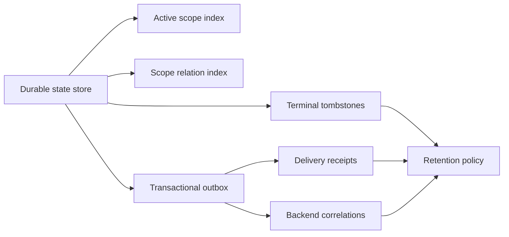
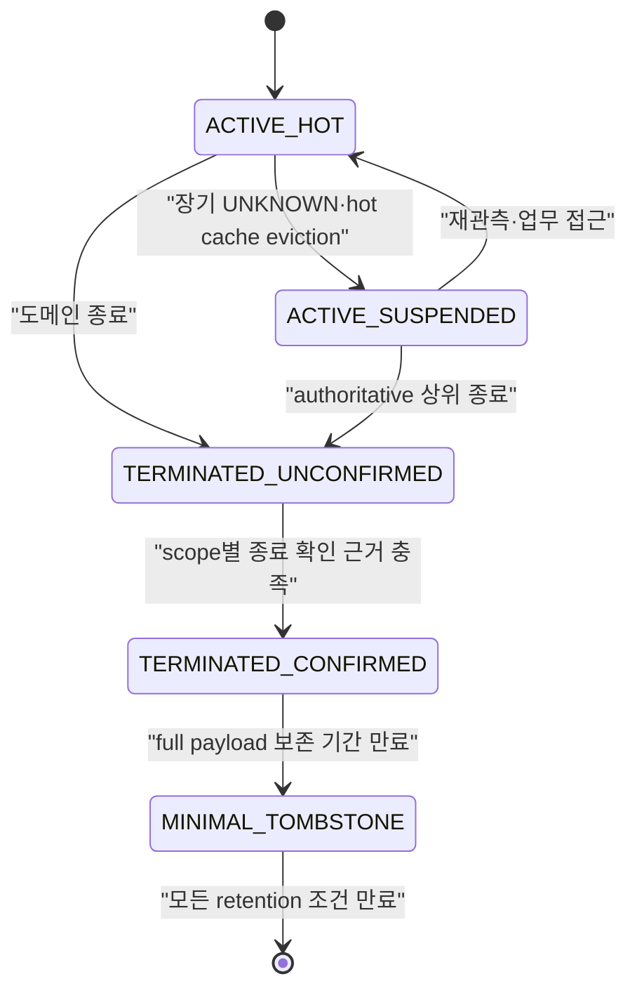

# Jetson 상태 보존 및 Retention 계약

> 상태: Draft · 관련 이슈: S15P11E202-461 · 범위: Jetson target domain contract · 비범위: 구현 상세, 테스트 계획, 배포 계획

이 문서는 Jetson이 확정한 상태와 외부 전이를 어떻게 보존하고, 언제 전체 상태를 최소 정보로 축약하거나 제거할 수 있는지 정의한다. 저장 기술, DB schema, repository 구현은 다루지 않는다.

Backend와 상태를 비교하고 최종 적용 여부를 확인하는 방법은 [Jetson–Backend 상태 Reconciliation 계약](./05-backend-reconciliation-contract.md)을 따른다.

## 문제 정의

현재 상태 축약, 상태 저장, scope 검색, 종료 사실 보존, 중복 방지를 하나의 in-memory collection이 담당하면 다음 문제가 생긴다.

- 종료된 scope까지 active 조회 대상에 남는다.
- scope 종료 조회 비용이 전체 누적 사건 수에 비례한다.
- 프로세스 재시작 시 후보·OPEN·publication revision을 잃는다.
- domain state 변경과 outbox 기록이 분리되면 둘 중 하나만 성공할 수 있다.
- 네트워크 ACK 여부를 복구할 수 없어 재전송과 중복 방지를 함께 보장하기 어렵다.

목표는 모든 과거 상태를 영구 보관하는 것이 아니라, 현재 판단·복구·중복 방지에 필요한 정보만 책임에 맞게 분리하는 것이다.

## 보존 원칙

1. lifecycle 종료와 저장소 정리는 별개다.
2. 관측 `UNKNOWN`은 retention 만료나 lifecycle 종료의 근거가 아니다.
3. authoritative 현재 상태는 durable state store가 보유한다.
4. active index는 현재 활성 scope만 가리키는 파생 조회 구조다.
5. terminal scope 전체를 active store에 계속 보존하지 않는다.
6. terminal scope는 필요한 최소 tombstone으로 축약할 수 있다.
7. 공개 전이와 이를 만든 domain state 변경은 하나의 consistency boundary에서 확정한다.
8. 공개 payload는 생성 시점의 immutable 사실이며 retry 때 현재 상태로 재구성하지 않는다.
9. Backend에 공개한 전이는 최종 적용을 확인하지 못한 채 시간이 지났다는 이유로 삭제하지 않는다.
10. 메모리에서 내리는 것과 durable state를 삭제하는 것을 구분한다.

## 논리 구성요소



### Durable state store

PROVISIONAL과 ACTIVE scope의 authoritative snapshot을 보존한다.

최소한 다음 의미를 복구할 수 있어야 한다.

- ScopeRef와 domain state
- LifecyclePhase와 transition sequence
- ObservationState와 마지막 신뢰 관측 시각
- scope별 누적 trusted duration
- record version
- publication revision
- domain key와 lifetime scope 관계
- Backend correlation
- payload contract version

raw frame, 반복 bbox, 매 frame의 동일 신호는 현재 상태 복구에 필요하지 않으므로 기본 durable state 대상이 아니다.

### Active scope index

현재 PROVISIONAL·ACTIVE scope를 빠르게 찾기 위한 파생 구조다.

필요한 조회는 다음과 같다.

```text
ScopeRef로 현재 상태 조회
domain key로 현재 활성 aggregate 조회
lifetime scope로 연결된 활성 Incident 조회
ParkingSession으로 연결된 활성 child scope 조회
subject·victim 관계로 BlockingRelation 조회
```

Active index는 별도의 authoritative state가 아니다.

- durable state에서 재구성할 수 있어야 한다.
- commit된 상태만 반영한다.
- terminal scope를 포함하지 않는다.
- cache miss가 lifecycle 의미를 바꾸지 않는다.

### Scope relation index

scope 사이의 조회 관계를 표현한다.

대표 관계:

| 관계 | 용도 |
|---|---|
| `LIFETIME_SCOPE` | Incident를 ZoneVisit·ParkingEpisode·BlockingRelation 종료와 연결 |
| `SESSION` | Session 종료 시 관련 scope 조회 |
| `SUBJECT` | BlockingRelation·Incident의 가해 차량 관계 |
| `VICTIM` | BlockingRelation·Incident의 피해 차량 관계 |
| `DERIVED_FROM` | 어떤 상태가 평가 근거였는지 추적 |
| `CORRELATED_WITH` | lifecycle 종속 없이 업무·전송 ID 연결 |

관계가 저장됐다고 자동 종료가 발생하지 않는다. 종료 전파 의미는 [Jetson Scope 전파 및 종료 계약](./03-scope-propagation-contract.md)에서만 정의한다.

### Tombstone

terminal scope 전체를 보존하는 archive가 아니라 다음을 위한 최소 종료 사실이다.

- terminal ID 재사용 방지
- stale observation·command 거부
- publication revision 중복 방지
- 늦은 ACK와 reconciliation 처리
- 같은 domain key의 이전 사건과 새 사건 구분
- child·evidence·delivery 정리 여부 확인

### Transactional outbox

Backend에 공개할 domain transition을 네트워크와 분리해 보존한다.

Outbox는 다음을 보유한다.

- delivery ID
- aggregate type·ID
- publication revision
- transition type
- Idempotency-Key
- immutable payload와 transition hash
- destination
- delivery state
- retry 정보
- Backend ACK와 오류 요약

Outbox는 domain 판단을 바꾸지 않는다.

### Delivery receipt

성공한 outbox 전체 payload를 영원히 보존하지 않고도 다음을 증명하기 위한 최소 기록이다.

- 어떤 Idempotency-Key가 성공했는가
- 어떤 aggregate revision이 적용됐는가
- 어떤 payload hash가 전송됐는가
- 언제 Backend가 적용했는가
- 어떤 Backend correlation을 받았는가

### Backend correlation

Jetson aggregate와 Backend 업무 ID의 연결이다.

```text
incidentId ↔ eventId
incidentId ↔ requestId
incidentId ↔ notificationId
parkingEpisodeId ↔ Backend parking state
verification attempt ↔ requestId
```

Correlation은 domain identity를 대체하지 않는다. `eventId`를 Incident ID로 사용하거나 `requestId`를 vehicle identity로 사용하지 않는다.

## Consistency boundary

공개 전이를 만드는 상태 변경은 다음 단위로 함께 확정돼야 한다.

```text
domain snapshot 또는 tombstone
+ active·relation index 변경
+ publication revision 증가
+ immutable outbox message
```

일부만 성공한 상태를 허용하지 않는다.

### Incident OPEN

```text
CANDIDATE → OPEN
+ publication revision 증가
+ lifetime scope 관계 유지
+ OPEN outbox 생성
```

### Incident RESOLVE

```text
OPEN·CLEAR_PENDING → RESOLVED
+ active index에서 제거
+ relation index에서 제거
+ terminal tombstone 생성
+ RESOLVE outbox 생성
```

### Candidate 취소

```text
PROVISIONAL → CANCELED
+ active index에서 제거
+ 공개 outbox 없음
```

### Scope 종료

하나의 ZoneVisit이나 ParkingSession 종료로 여러 Incident가 함께 끝나면, 해당 종료 사실과 이에 따른 child 상태 변경을 하나의 논리적 consistency boundary로 취급한다. 중간 일부 Incident만 RESOLVE된 상태를 정상 결과로 인정하지 않는다.

## 저장 내구성 등급

모든 관측을 같은 수준으로 보존하지 않는다.

| 등급 | 대상 | 보존 의미 |
|---|---|---|
| Ephemeral | evidence로 승격되지 않은 raw frame, bbox, TrackSegment, 순간 신호 | 재시작 후 새 관측으로 다시 생성 |
| Checkpointed | PhysicalVehicle 관측, ZoneVisit timer, STOP_PENDING 누적 시간 | 안전한 하한을 주기적으로 복구 |
| Immediately durable | EntryMatch, ContextBinding, Session, PARKED·UNPARKED, Incident 전이, Verification, outbox | 전이와 동시에 보존 |

Checkpoint 사이의 장애로 누적 시간을 잃을 수는 있다. 잃은 시간을 추정해 보충하지 않는다. 이 원칙은 확정을 늦출 수 있지만 거짓 확정을 만들지 않는다.

## 저장 단계



### ACTIVE_HOT

현재 처리에서 반복 조회되는 active scope다. 메모리 cache에 둘 수 있다.

### ACTIVE_SUSPENDED

domain lifecycle은 ACTIVE지만 장기 `UNKNOWN`이거나 당장 반복 조회하지 않는 상태다.

- hot cache에서 내릴 수 있다.
- durable state는 유지한다.
- RESOLVE·UNPARKED·EXIT를 만들지 않는다.
- 재관측이나 reconciliation으로 ACTIVE_HOT에 돌아올 수 있다.

### 종료 확인 근거

모든 terminal scope가 Backend publication을 갖는 것은 아니다. Scope는 종료 시 다음 중 하나의 확인 근거를 명시한다.

| 확인 근거 | 적용 대상 | confirmed 조건 |
|---|---|---|
| `PUBLICATION_APPLIED` | UNPARKED, Incident RESOLVE, MoveVerification 결과, Jetson EXIT처럼 terminal과 직접 연결된 Backend publication이 있는 scope | Backend가 해당 aggregate의 최종 공개 revision과 transition hash 적용을 확인함 |
| `AUTHORITATIVE_PARENT_CLOSED` | Session EXIT로 끝났고 별도 UNPARKED처럼 직접 terminal publication을 만들지 않는 child scope | Backend의 authoritative parent 종료와 로컬 child 종료가 연결됐으며, child가 만든 다른 publication은 모두 적용됨 |
| `LOCAL_ONLY` | 외부에 공개되지 않은 candidate, TrackSegment, 내부 ZoneVisit·relation 등 | 공개 revision·correlation이 없고 local child·replay·stale-input 방지 조건을 모두 충족함 |

Evidence의 영구 실패처럼 publication ACK로 완료할 수 없는 workflow는 명시적인 `EVIDENCE_UNAVAILABLE` 확인을 종료 근거로 사용한다. 어떤 근거를 사용하더라도 미완료 publication을 무시하거나 공개 사실을 local-only로 강등할 수 없다.

PARKED나 Incident OPEN처럼 scope가 ACTIVE일 때 이미 만든 선행 publication은 terminal 확인 근거 자체는 아니지만, 해당 scope를 축약하기 전에 모두 적용돼 있어야 한다.

### TERMINATED_UNCONFIRMED

로컬 lifecycle은 끝났지만 해당 scope에 적용되는 종료 확인 근거가 아직 충족되지 않았다.

다음 중 존재하는 정보를 완전한 형태로 보존한다.

- terminal 상태와 종료 사유
- 정확한 publication payload
- publication revision과 transition hash
- Idempotency-Key
- Backend correlation
- evidence reference

공개된 적 없는 local-only scope에는 publication payload·revision·Idempotency-Key가 없을 수 있다. 이 경우 그것을 임의로 생성하지 않고 local 종료·참조·replay 근거를 보존한다.

### TERMINATED_CONFIRMED

scope별 종료 확인 근거를 충족한 상태다. 공개 scope는 Backend가 동일 aggregate revision과 transition hash를 적용했음을 확인한 상태이며, 늦은 재전송과 reconciliation을 위해 안전 구간 동안 full record를 더 유지한다. Local-only scope는 stale input·재생 방지에 필요한 local 안전 구간을 적용한다.

### MINIMAL_TOMBSTONE

다음 최소 정보만 남긴다.

```text
ScopeRef
final domain state
termination kind·reason·time
final lifecycle sequence
final publication revision (if published)
domain key 또는 key hash
lifetime scope reference
last transition hash (if published)
termination confirmation basis·evidence reference
retainUntil
```

## Scope별 보존

| Scope | ACTIVE 보존 | 기본 종료 확인 근거 | Tombstone 목적 |
|---|---|---|---|
| Camera source session | 현재 실행 동안 | `LOCAL_ONLY` | 원칙적으로 불필요 |
| TrackSegment | 메모리 중심 | `LOCAL_ONLY` | 불필요 |
| PhysicalVehicle | 관측 또는 session 연결 동안 | `LOCAL_ONLY` + child 정리 | identity 재사용·merge 추적 |
| EntryMatchAttempt | PENDING 동안 | `LOCAL_ONLY` + 결과 조회·command replay 계약 | attempt 중복 방지 |
| ContextBinding | Session 활성 동안 | `AUTHORITATIVE_PARENT_CLOSED` 또는 `LOCAL_ONLY` correction | 잘못된 재연결 방지 |
| ParkingSessionMirror | ACTIVE 동안 | Jetson EXIT는 `PUBLICATION_APPLIED`, Backend 선종료는 `AUTHORITATIVE_PARENT_CLOSED` | session 중복·stale 입력 방지 |
| ZoneVisit | non-terminal 동안 | `LOCAL_ONLY` + 방문 기반 Incident 정리 | 같은 visitId 재생성 방지 |
| ParkingEpisode | non-terminal 동안 | UNPARKED는 `PUBLICATION_APPLIED`, Session EXIT 종료는 `AUTHORITATIVE_PARENT_CLOSED` | episode 중복 전이 방지 |
| BlockingRelation | non-terminal 동안 | `LOCAL_ONLY` + 관련 Incident 정리 | relation 중복·stale 관계 방지 |
| Incident | CANDIDATE·OPEN·CLEAR_PENDING 동안 | 공개 사건은 `PUBLICATION_APPLIED`, 후보 취소는 `LOCAL_ONLY` | incidentId·revision·이전 key 구분 |
| MoveVerificationAttempt | ACCEPTED·CHECKING 동안 | 결과가 있으면 `PUBLICATION_APPLIED`, 미공개 취소는 `LOCAL_ONLY` | command 중복 방지 |
| Outbox message | 미완료 동안 | Backend 적용 확인 | receipt로 축약 |
| EvidenceArtifact | 캡처·업로드 동안 | 업로드 ACK 또는 명시적 `EVIDENCE_UNAVAILABLE` 확인 | metadata·checksum·실패 근거 보존 |

## Active scope 보존

다음 active 상태에는 시간 기반 자동 삭제를 적용하지 않는다.

- session에 연결된 PhysicalVehicle
- PARKED ParkingEpisode
- OPEN Incident
- 활성 ParkingSession
- 진행 중 MoveVerification
- 미완료 outbox
- DEAD_LETTER
- Backend 적용을 확인하지 못한 terminal scope

장기 UNKNOWN으로 메모리 사용량이 증가하면 `ACTIVE_SUSPENDED`로 내린다. 이를 `TERMINATED`로 바꾸지 않는다.

Active scope를 최종 정리하려면 신뢰 가능한 자체 종료 또는 Backend가 확인한 authoritative Session 종료가 필요하다.

## Candidate retention

Backend에 공개된 적 없는 후보는 제한적으로 만료시킬 수 있다.

| 후보 | 만료 가능 조건 |
|---|---|
| PhysicalVehicle candidate | binding·child·공개 사실 없음 |
| ZoneVisit ENTERING | 공개 사건 없음, 후보 replay window 만료 |
| ParkingEpisode STOP_PENDING | 공개 사실 없음, 복구 checkpoint 정책 만료 |
| BlockingRelation candidate | OPEN Incident 없음 |
| Incident candidate | publication revision이 0 |

관측 `UNKNOWN` 자체는 후보 취소 근거가 아니다. 운영상 보존 기한으로 내부 후보를 정리한다면 다음처럼 상태축을 구분하고 외부 RESOLVE를 만들지 않는다.

```text
domain state    = CANCELED
lifecycle phase = TERMINATED
termination kind = EXPIRED
reason code     = LOCAL_CANDIDATE_RETENTION_EXPIRED
```

## Incident tombstone과 재성립

동일 domain key의 이전 tombstone이 있다는 이유만으로 새 Incident를 영구 차단하지 않는다.

```text
새 MATCHED 시각 ≤ 이전 resolvedAt
→ stale signal이므로 무시 또는 거부

새 MATCHED 시각 > 이전 resolvedAt
+ 신뢰 가능한 clear 구간 존재
+ lifetime scope가 유효
→ 새 incidentId 생성 가능
```

이미 종료된 ZoneVisit 같은 terminal lifetime scope에는 새 Incident를 만들지 않는다. lifetime scope tombstone이 stale recreation을 차단한다.

## Outbox retention

| Delivery state | 자동 삭제 |
|---|---|
| `PENDING` | 금지 |
| `IN_FLIGHT` | 금지 |
| `RETRY_WAIT` | 금지 |
| `DEAD_LETTER` | 금지 |
| `DELIVERED`, `BackendApplicationConfirmation` 미확인 | 금지 |
| `DELIVERED`, revision·hash의 `BackendApplicationConfirmation` 확인 | 안전 구간 뒤 receipt로 축약 가능 |
| Delivery receipt | Backend idempotency·replay 기간 뒤 purge 가능 |

동일 publication을 retry할 때 현재 aggregate에서 payload를 다시 만들지 않는다. 생성 당시 immutable payload와 같은 Idempotency-Key를 사용한다.

DEAD_LETTER는 관리자가 재처리하거나 명시적으로 포기하기 전까지 보존한다. domain lifecycle을 되돌리거나 undelivered publication을 공간 확보 목적으로 삭제하지 않는다.

## Evidence retention

전달 가능한 Evidence가 Backend upload ACK를 받기 전:

- 복구 가능한 evidence 파일 삭제 금지
- Incident RESOLVE·Session EXIT 이후에도 업로드 계속
- DEAD_LETTER 자동 삭제 금지

Backend ACK 이후:

- evidence binary의 authoritative owner는 Backend다.
- Jetson은 local evidence grace 기간 동안 파일을 유지한다.
- 진행 중 업무가 local 파일을 필요로 하면 삭제를 연기한다.
- 파일 삭제 후에도 evidence ID, checksum, capturedAt, Backend correlation은 Incident tombstone과 같은 의미 기간 동안 보존한다.

`FAILED` Evidence는 전달 성공으로 간주하지 않는다. 복구 가능한 binary가 있으면 명시적 처리 전까지 보존한다. binary가 이미 손실·손상됐거나 복구 불가능함이 확인됐다면 실패 reason·checksum 가능 여부·Incident revision을 보존하고, Backend 또는 계약된 운영 권한자의 `EVIDENCE_UNAVAILABLE` 확인 뒤에만 parent 보존 blocker를 해제한다. 이 확인 뒤에도 실패 metadata는 Incident tombstone과 같은 의미 기간 동안 남긴다.

## Retention 계약 변수

기간 숫자를 도메인 코드에 고정하지 않고 다음 계약 변수로 표현한다.

| 변수 | 의미 |
|---|---|
| `W_backend_idempotency` | Backend가 Idempotency-Key 결과를 기억한다고 보장하는 기간 |
| `W_backend_applied_edge` | Backend가 aggregate별 applied revision·transition hash·correlation을 조회 가능하게 보존하는 기간 |
| `W_command_replay` | 동일 command가 다시 전달될 수 있는 최대 기간 |
| `W_offline_retry` | 네트워크 장애 뒤 publication을 재시도하는 운영 기간 |
| `W_reconciliation_overlap` | Backend 확인 뒤 local record를 추가 보존하는 안전 구간 |
| `W_candidate_replay` | 늦은 observation으로 후보가 재생될 수 있는 구간 |
| `W_evidence_local` | Evidence ACK 뒤 local binary 보존 기간 |

각 기간은 다음 기준 시점에서 시작한다.

| 변수 | 기준 시점 |
|---|---|
| `W_offline_retry` | immutable publication이 생성된 `recordedAt` |
| `W_backend_idempotency` | Backend가 해당 Idempotency-Key를 처음 적용하거나 처리 결과로 고정한 시각 |
| `W_backend_applied_edge` | Backend의 `appliedAt` |
| `W_reconciliation_overlap` | Jetson이 유효한 `BackendApplicationConfirmation`을 확보한 시각 |
| `W_command_replay` | command가 복구 가능하게 접수된 시각과 terminal 결과 생성 시각 중 늦은 시각 |
| `W_candidate_replay` | 공개되지 않은 candidate가 terminal이 된 시각 |
| `W_evidence_local` | Backend evidence ACK 시각 |

Backend가 제공하는 retention contract나 application confirmation은 가능한 경우 계산된 `retainUntil`도 함께 제공한다. 기준 시각이 불명확하면 더 이른 purge를 추정하지 않는다.

필수 관계:

```text
W_backend_idempotency
≥ W_offline_retry

W_backend_applied_edge
≥ W_offline_retry + W_reconciliation_overlap

delivery receipt retention
≥ max(W_backend_idempotency, W_backend_applied_edge)

published scope tombstone retention
≥ delivery receipt retention

processed command retention
≥ W_command_replay

terminal full payload retention
≥ Backend final revision 확인 시점 + W_reconciliation_overlap

evidence metadata retention
≥ Incident tombstone retention
```

구체적인 값은 Backend와 운영 계약에서 정한다. 계약 기간이 짧아져도 이미 생성된 record의 `retainUntil`을 소급해 당기지 않는다. 기간이 길어지면 기존 record를 연장할 수 있다.

## Compaction과 Purge 조건

Full terminal record를 `MINIMAL_TOMBSTONE`으로 축약하는 것과 tombstone 자체를 최종 삭제하는 것은 다른 전이다.

### Full record → MINIMAL_TOMBSTONE

다음을 모두 만족해야 한다.

1. scope별 종료 확인 근거가 충족됐다.
2. 관련 미완료 또는 `DEAD_LETTER` publication이 없다.
3. full payload·evidence를 요구하는 reconciliation·충돌·관리자 보존이 없다.
4. 공개 scope는 Backend 최종 적용 확인 뒤 `W_reconciliation_overlap`이 지났다.
5. local-only scope는 child·stale-input·local replay 안전 구간이 지났다.

### MINIMAL_TOMBSTONE → Purged

Terminal scope는 다음을 모두 만족해야 최종 purge할 수 있다.

1. 해당 scope의 종료 확인 근거가 계속 유효하다.
2. 공개 scope라면 관련 publication이 모두 Backend에 적용됐고 최종 revision·hash 확인 기록이 남아 있다.
3. 미완료 또는 `DEAD_LETTER` outbox가 없다.
4. active child scope가 없다.
5. 미완료 EvidenceArtifact가 없고, 영구 실패 evidence는 `EVIDENCE_UNAVAILABLE` 확인을 받았다.
6. 진행 중 MoveVerification이 참조하지 않는다.
7. 해당되는 command replay 기간이 끝났다.
8. 공개 scope에는 Backend idempotency·applied-edge 보장 기간과 reconciliation overlap이 끝났다.
9. local-only scope에는 stale-input·candidate replay 안전 구간이 끝났다.
10. 관리자 보존·reconciliation 충돌 대상이 아니다.

Backend에 공개된 전이는 적용 확인 없이 시간이 오래 지났다는 이유로 purge하지 않는다. 반대로 공개된 적 없는 local-only scope에는 존재하지 않는 Backend revision 확인을 요구하지 않는다.

## 재시작 복구

재시작 시 다음 순서를 의미 계약으로 보장한다.

1. PROVISIONAL·ACTIVE snapshot을 복구한다.
2. domain lifecycle은 복구한 상태를 유지한다.
3. 관측 기반 scope의 ObservationState를 `UNKNOWN`으로 시작한다.
4. 중단 시간을 trusted duration에 포함하지 않는다.
5. active·relation index를 authoritative state에서 재구성한다.
6. 미완료 outbox와 command workflow를 재개한다.
7. delivered 여부가 불명확한 publication은 같은 revision·Idempotency-Key로 확인한다.
8. Backend reconciliation로 Session·context·applied revision을 비교한다.

TrackSegment나 raw bbox는 복구하지 않는다. 복구된 PhysicalVehicle·ZoneVisit·ParkingEpisode·Incident는 새 관측을 얻기 전까지 `UNKNOWN`이다.

## 보존 불변조건

1. cache eviction은 lifecycle transition을 만들지 않는다.
2. ACTIVE·UNKNOWN scope를 retention 시간만으로 종료하지 않는다.
3. 공개 전이와 domain state 변경이 서로 다른 consistency boundary에 놓이지 않는다.
4. terminal scope를 active 조회 대상으로 계속 보존하지 않는다.
5. tombstone은 full archive가 아니라 중복·복구에 필요한 최소 사실이다.
6. Backend 확인 전 publication payload를 축약하지 않는다.
7. DEAD_LETTER와 미업로드 evidence를 자동 삭제하지 않는다.
8. 새 Incident를 만들 수 있다는 이유로 이전 tombstone을 즉시 삭제하지 않는다.
9. Backend 업무 상태를 Jetson domain lifecycle의 purge 근거로 사용하지 않는다.
10. retention 정책 변경으로 기존 보존 기한을 소급 단축하지 않는다.
