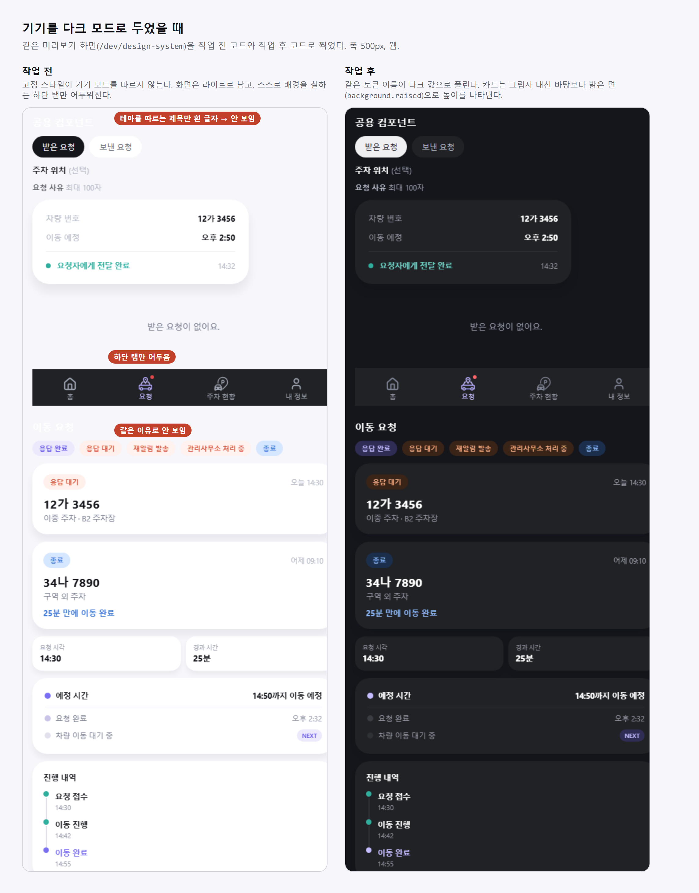
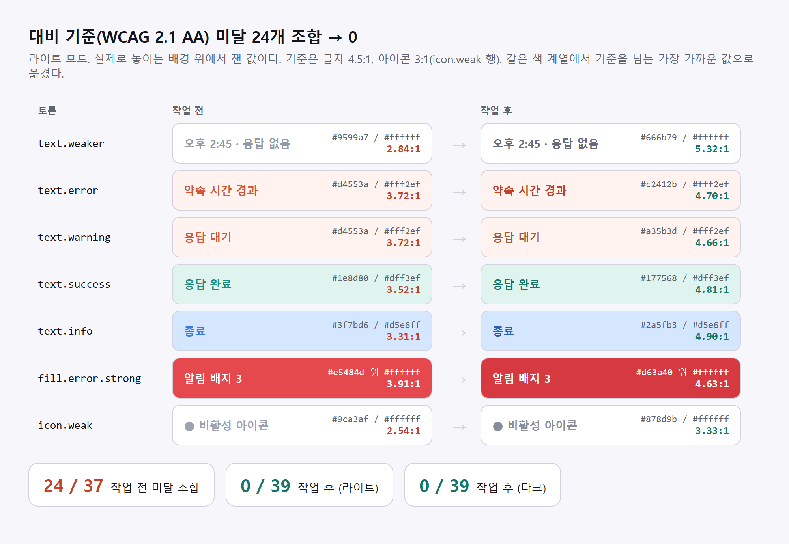

# 주차바로 디자인 시스템 — 다크 모드가 동작하지 않던 원인을 찾아 구조로 고치기

> **한 줄 요약**
> 색 토큰이 있는데도 화면 코드에서 팔레트를 직접 쓰던 상태(의미 토큰 26회, 팔레트 직접 사용 463회). 원인을 스타일 구조에서 찾아 수정, 기능 하나를 끝까지 이전, 린트와 대비 검사로 재발 방지

| 이동 요청 기능의 색 직접 사용 | 대비 기준 미달 (라이트) | 다크 모드 |
|---|---|---|
| 팔레트 130회 → **0**<br>색상 값 하드코딩 86회 → **0** | 37개 조합 중 24개 → 39개 중 **0개**<br>다크도 39개 중 0개 | 대부분 라이트로 고정 → 이동 요청 화면 **5개 지원** |



| 항목 | 내용 |
|---|---|
| 프로젝트 | 주차바로 — 아파트 주차장의 불편 주차를 감지하고, 차주의 개인정보를 드러내지 않고 이동 요청을 중계하는 스마트 주차 관리 서비스. 입주민 앱(React Native)과 관리자 웹(Vue) |
| 기술 | Expo SDK 54, React Native, TypeScript / Vue 3 |
| 시점 | 프로젝트 기간(2026년 7~8월)에는 관리자 웹 토큰과 앱 공용 컴포넌트 담당. 이 글의 개선은 **프로젝트 종료 후 회고에서 발견해 혼자 진행**(2026년 11월) |
| 개선 규모 | 소스 파일 90개 (브랜치 `refactor/fe/usage-based-color-tokens`) |

---

## 1. 프로젝트 중 담당 업무

앱의 색·간격·글꼴 토큰 기초는 팀원이 정리(2026-07-29). 그 위에서 두 가지 담당.

**관리자 웹으로 토큰 이식.** 앱의 TypeScript 토큰(`colors.ts` 등)을 Vue의 CSS 변수(`--color-*`, `--spacing-*`)로 옮겨 두 플랫폼의 톤 통일. 관리자 대시보드에는 앱에 없는 상태 표현이 필요해 확장 토큰 `--panel-*`을 **oklch**로 새로 정의. success / warning / info / danger와 각각의 옅은 면(`-soft`)·글자색, 사이드바 그라데이션, 카드·팝업 그림자를 라이트와 다크 모두 설계. 상태 배지 컴포넌트 `StatusTag`의 `tone` prop을 이 토큰과 연결(이후 팀원이 톤 몇 개 추가).

**앱 공용 컴포넌트.** Figma 기준 `MainIcon`, `BottomNavBar`, `BackButton` 제작, `Screen` 슬롯 추가, 화면 헤더와 배경 그라데이션 통합.

| 영역 | 담당 |
|---|---|
| 앱 토큰 기초 (`baro-app/src/styles`) | 팀원. 주차 도면용 칸 배경색 등 일부만 추가 |
| 관리자 웹 토큰 (`admin-web/src/styles`) | 본인 |
| 앱 공용 컴포넌트 (`components/ui`) | 팀원과 분담. 위에 적은 항목이 본인 담당 |
| **이 글의 색 토큰 개선** | 본인 (프로젝트 종료 후) |

## 2. 문제 발견 — 토큰은 있지만 쓰이지 않던 구조

회고 중 앱을 다크 모드로 켰을 때 화면 대부분이 라이트 그대로인 상태 확인. 테마 토큰(`Colors.light` / `Colors.dark`)과 테마 훅(`useTheme()`)은 처음부터 존재. 색 사용 방식을 세어 본 결과:

| 색을 쓰는 방식 | 앱 전체 (파일 324개) |
|---|---|
| 테마 토큰 `theme.*` | **26회** |
| 팔레트 직접 사용 `Palette.gray600` 등 | **463회** (파일 118개) |
| 색상 값 하드코딩 `'#9599a7'` 등 | **159회** |

원인은 사람이 아닌 구조. 스타일 파일은 `export const styles = StyleSheet.create({...})`로 모듈 로딩 시점에 한 번 만들어지는 고정 객체. 그래서 컴포넌트 안에서만 부를 수 있는 테마 훅 사용 불가, 스타일 작성자는 팔레트나 값을 직접 적을 수밖에 없는 구조. 여기서 이어진 세 가지 문제:

- **반쪽짜리 다크 모드.** 기기 모드를 따르는 몇몇 요소(하단 탭, 테마 글자)만 바뀌고 나머지는 라이트로 남는 상태. 위 그림의 "작업 전"
- **같은 역할의 색이 여러 값으로 분산.** 오류 글자색만 해도 `#d4553a`, `#c8492e`, `#d84a36`, `#e5484d` 네 가지 혼재
- **대비 기준 미달.** 날짜·안내 문구에 쓰던 보조 글자색 `#9599a7`는 흰 배경에서 2.84:1로, 본문 글자 기준(4.5:1)의 3분의 2에도 못 미치는 수준. 이 값이 앱 전체 16곳에 하드코딩

## 3. 이름 규칙 — 색상명이 아니라 쓰임새로

기존 테마 토큰 17개에 몇 개를 덧붙이는 방법도 검토. 하지만 이름 규칙 없이 덧붙이면 다음 사람이 또 임의로 이름을 짓는 문제. 그래서 의미 층을 **`요소.톤.강조`** 규칙으로 새로 설계. 규칙이 있으면 빠진 색이 "규칙의 빈칸"으로 드러나고, 이름만으로 쓸 곳 파악 가능.


실제 컴포넌트에 적용한 모습:


규칙을 적용하며 바로잡은 두 가지:

- **"경고"와 "오류" 분리.** 응답 대기·재알림 배지가 기한 초과와 같은 주황을 쓰던 상태. 아직 기다리는 중인 상태와 이미 늦은 상태는 의미가 달라 `text.warning`(갈색 계열)과 `text.error`로 분리
- **유틸이 색 대신 의미를 반환.** 타임라인 데이터를 만드는 유틸이 `dotColor: '#e5493d'`처럼 색 값을 직접 반환하던 구조. 이제는 `tone: 'error'`라는 의미만 반환하고, 컴포넌트가 현재 테마의 토큰으로 변환

```diff
 export type RequestTimelineStep = {
   label: string;
   detail: string;
-  dotColor?: string;
-  labelColor?: string;
+  /** 없으면 기본(완료된 일반 단계) 모양으로 그린다. */
+  tone?: TimelineTone; // 'brand' | 'warning' | 'error'
 };
```

## 4. 대비 — 라이트와 다크 모두 기준 통과

글자와 아이콘 토큰은 **실제로 놓이는 배경 위에서** WCAG 2.1 AA 기준 통과(글자 4.5:1, 아이콘 3:1). 흰 배경만 재면 놓치는 경우가 많음. 예를 들어 오류 글자는 흰 배경에서 4.07이지만, 실제로 놓이는 옅은 주황 면 위에서는 3.72.

옛 값을 새 구조에 그대로 넣고 검사한 결과 37개 조합 중 24개 미달. 미달인 색은 같은 색 계열에서 기준을 넘는 가장 가까운 값으로 옮겨, 화면 인상은 유지하고 조금 진해지는 정도로 마무리.



다크 값은 "같은 역할은 같은 대비 수준"이 원칙. 라이트에서 `text.weak`가 `text.strong`보다 한 단계 약하면 다크에서도 동일. 다크에서는 그림자가 보이지 않아 카드처럼 떠 있는 면은 바탕보다 밝은 면(`background.raised`)으로 높이 표현.


**트레이드오프.** 보조 글자를 기준에 맞추자 `text.weak`(5.94:1)와 `text.weaker`(5.32:1)의 차이가 거의 사라지는 문제. 옅은 단계를 옛 값 그대로 두고 대비 검사 예외로 적는 선택지도 검토. 하지만 11~12px의 작은 글자가 2.84:1로 남는 쪽이 더 나쁘다고 판단해, 위계는 색 대신 글자 크기와 굵기로 표현.

## 5. 구조 — 스타일 파일이 테마를 받는 구조로


고정 스타일 문제를 푸는 네 가지 방법 비교:

| 방법 | 판단 |
|---|---|
| 색만 컴포넌트에서 인라인으로 덮어쓰기 | 스타일이 두 곳으로 갈라짐. 색 참조가 200곳이라 컴포넌트가 지저분해짐 |
| 플랫폼 색(`PlatformColor`) | 웹 미지원. 이 프로젝트는 Android·iOS·Web 동시 지원 |
| 스타일 라이브러리 도입 | 기능 하나를 위해 넣기에는 큰 새 의존성 |
| **스타일을 "토큰을 받는 함수"로** (선택) | 파일 위치 규칙(`*.styles.ts`) 유지, 새 의존성 없음 |

```ts
// request-timeline-card.styles.ts
export const createStyles = (t: ColorTokens) =>
  StyleSheet.create({
    stepDetail: { fontSize: 11, color: t.text.weaker },
  });

// request-timeline-card.tsx
const styles = useThemedStyles(createStyles);
```

`useThemedStyles`는 (스타일 함수, 모드) 쌍마다 스타일을 한 번만 만들어 재사용. 모드가 둘뿐이라 스타일 함수 하나당 최대 두 번 호출, 렌더마다 `StyleSheet.create`를 다시 부르지 않는 구조.

**다크 모드는 화면 단위로 적용.** 헤더나 배경 같은 공용 컴포넌트는 아직 옮기지 않은 화면에서도 쓰이는 상황. 그런 화면은 글자색이 라이트로 고정되어 있어, 공용 컴포넌트만 어두워지면 흰 제목이 밝은 배경에 묻히는 문제. 그래서 `withAdaptiveColors(Screen)`으로 감싼 화면 안에서만 기기 모드를 따르도록 처리. 옮기지 않은 화면이 지금과 똑같이 보이는지는 단위 테스트로 확인.

## 6. 범위 판단 — 앱 전체가 아니라 기능 하나를 끝까지

팔레트를 직접 쓰는 파일은 118개. 전부 옮기면 화면마다 확인이 필요하고 팀 코드 전반을 건드리는 부담. 반대로 토큰 정의만 하고 코드를 그대로 두면 규칙이 실제로 동작하는지 증명 불가.

그래서 **색 참조가 가장 많이 몰린 이동 요청 기능 하나**(파일 74개, 색 참조 약 220곳)와 그 화면이 쓰는 공용 컴포넌트 7개를 끝까지 이전. 이 범위에서는 팔레트 직접 사용과 하드코딩 모두 0, 다크 모드 전 구간 동작. 나머지는 린트 경고로 남겨 다음 이전 대상을 숫자로 확인 가능.

| 구분 | 이동 요청 기능 | 앱 전체 |
|---|---|---|
| 팔레트 직접 사용 | 130 → **0** | 463 → 315 |
| 색상 값 하드코딩 | 86 → **0** | 159 → 68 |

색이 눈에 띄게 바뀌는 곳(값 합치기, 대비 조정) 14가지는 수정 전 견본을 나란히 놓은 매핑 표로 정리해 하나씩 확정. 그 밖에는 눈으로 구분되지 않는 값을 팔레트 단계로 합친 정도.

## 7. 재발 방지

구조를 바꿔도 다음 사람이 다시 값을 적으면 원래대로 돌아가는 문제. 그래서 규칙을 문서가 아닌 도구에 적용.

**린트.** `src/styles` 밖에서 색상 값 문자열(`#rgb`, `rgba()` 등)과 `Palette` 가져오기 차단. 새 패키지 없이 ESLint 기본 규칙(`no-restricted-syntax`, `no-restricted-imports`)으로 구성. 옮긴 경로는 **오류**, 나머지는 **경고**라 기존 코드의 린트는 깨지지 않고, 남은 부채가 경고 146개로 드러나는 구조.

```text
# 옮긴 기능(move-request)에 색을 직접 적으면
  2:10  error    'Palette' import from '@/styles' is restricted. 용도 기반 토큰을 useColorTokens / useThemedStyles로 받아 사용하세요
  5:20  error    색상 값 대신 src/styles의 토큰을 사용하세요 (useThemedStyles)

# 아직 옮기지 않은 기능(vehicle)에서는
  1:37  warning  색상 값 대신 src/styles의 토큰을 사용하세요 (useThemedStyles)
```

작업 중 **기존 린트 규칙 일부가 처음부터 적용되지 않던 문제**도 발견. 설정 파일이 `eslint.config.js`와 `eslint.config.ts` 두 개였고, ESLint는 `.js`만 읽던 상태. `.ts`에 적어 둔 `no-console` 등의 규칙은 문서에만 있고 동작하지 않던 상황이라, 둘을 합쳐 하나로 정리.

**대비 검사.** `npm run check:contrast` 한 번으로 토큰 정의 파일의 값을 직접 읽어 라이트·다크 39개씩 조합 검사, 미달이 있으면 실패. 값을 스크립트에 따로 적지 않아 토큰을 바꾸면 검사도 함께 반영.

```text
[light] 조합 39개, 최저 대비 3.09
  모두 통과
[dark] 조합 39개, 최저 대비 4.04
  모두 통과
```

**미리보기 화면.** 이동 요청 화면은 로그인과 서버가 있어야 열리는 화면. 개발 빌드에서만 열리는 `/dev/design-system` 화면을 추가해, 서버 없이 토큰 견본과 실제 컴포넌트를 라이트·다크로 확인 가능. 이 글의 그림도 모두 이 화면에서 촬영.

## 8. 한계와 다음 단계

- **이전 범위는 기능 하나.** 나머지 기능에 팔레트 직접 사용 315회, 하드코딩 68회 잔존. 린트 경고가 곧 다음 작업 목록
- **CI 미연결.** CI(Jenkins)는 타입 검사만 실행하고, Node 20 환경이라 새 스크립트(Node 22.15 이상 필요) 실행 불가. 현재는 로컬 실행
- **두 프론트의 토큰을 수동으로 동기화.** 앱(TS)과 관리자 웹(CSS 변수)이 값을 복사해 쓰는 구조라 이름이 어긋난 곳 존재(`--space-*` / `--spacing-*`, 글꼴). 원본 하나에서 두 플랫폼용 토큰을 생성하는 구조가 다음 단계
- **주차 도면은 다크에서도 라이트.** 칸 색 자체가 정보라 별도 설계 필요
- **확인 범위.** 웹의 미리보기 화면에서 확인. 실제 이동 요청 화면(서버 필요)과 Android·iOS 기기는 미확인

---

## 근거

- 토큰 설명서: [`tokens.md`](../tokens.md)
- 전후 측정 기록과 명령: [`metrics.md`](../metrics.md)
- 옛 값 → 토큰 매핑 표: [`color-mapping.md`](../color-mapping.md)
- 설계 문서(검토한 대안): [`2026-11-26-usage-based-color-tokens-design.md`](../../superpowers/specs/2026-11-26-usage-based-color-tokens-design.md)

다시 재는 법 (`frontend/baro-app`):

```powershell
npm run count:colors; npm run check:contrast; npm run test:unit
```
