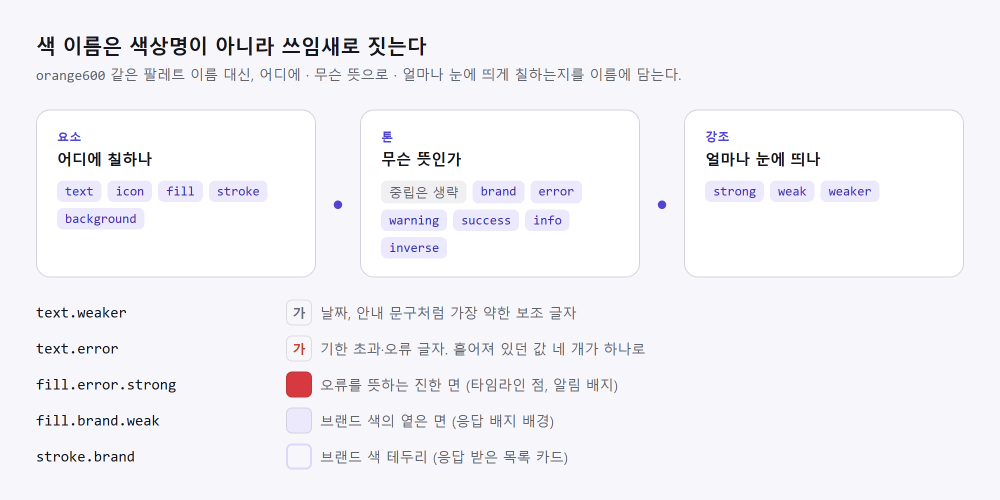
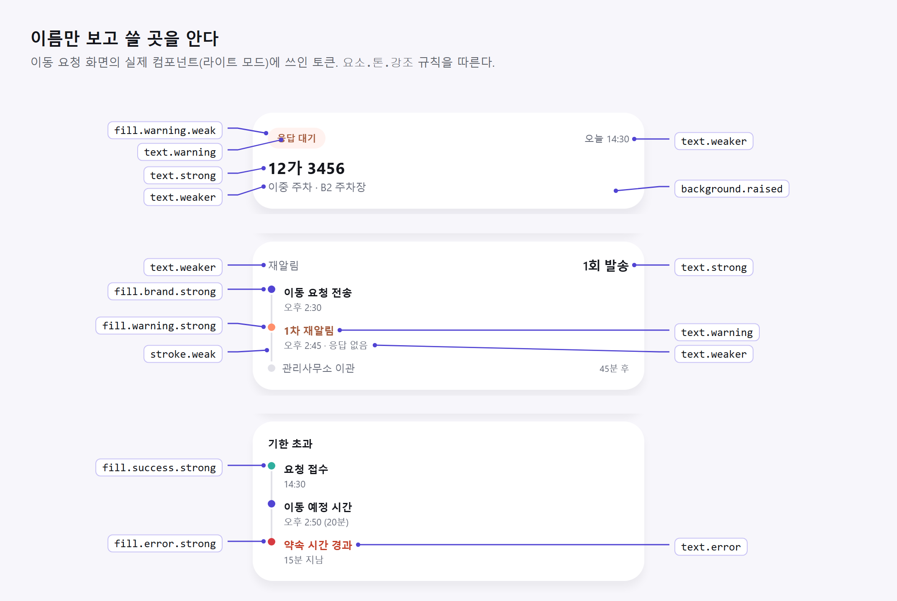
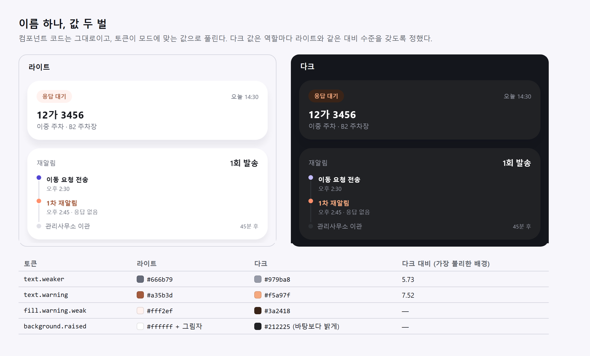
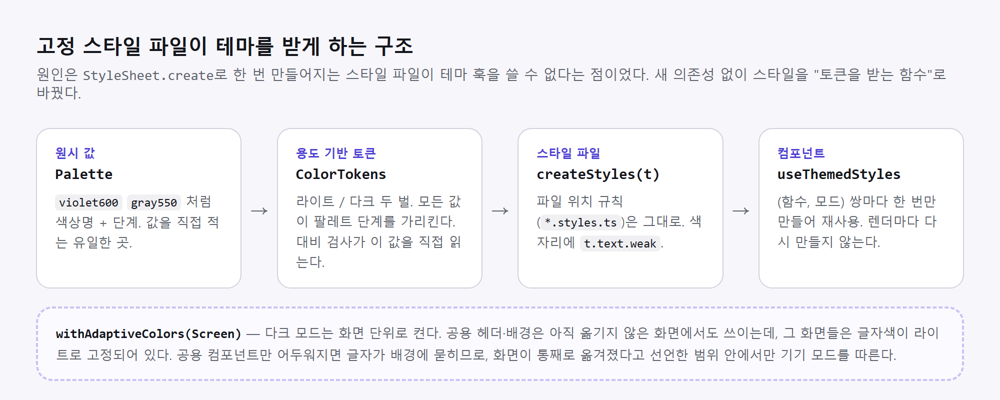

# 주차바로 디자인 시스템 — 다크 모드가 동작하지 않던 원인을 찾아 구조로 고치기

> **한 줄 요약**
> 색 토큰이 있는데도 화면 코드는 팔레트를 직접 쓰고 있었다(의미 토큰 26회, 팔레트 직접 사용 463회). 원인을 스타일 구조에서 찾아 고치고, 기능 하나를 끝까지 옮긴 뒤, 린트와 대비 검사로 다시 생기지 않게 막았다.

| 이동 요청 기능의 색 직접 사용 | 대비 기준 미달 (라이트) | 다크 모드 |
|---|---|---|
| 팔레트 130회 → **0**<br>색상 값 하드코딩 86회 → **0** | 37개 조합 중 24개 → 39개 중 **0개**<br>다크도 39개 중 0개 | 대부분 라이트로 고정 → 이동 요청 화면 **5개 지원** |


| | |
|---|---|
| 프로젝트 | 주차바로 — 아파트 주차장의 불편 주차를 감지하고, 차주의 개인정보를 드러내지 않고 이동 요청을 중계하는 스마트 주차 관리 서비스. 입주민 앱(React Native)과 관리자 웹(Vue) |
| 기술 | Expo SDK 54, React Native, TypeScript / Vue 3 |
| 시점 | 프로젝트 기간(2026년 7~8월)에는 관리자 웹 토큰과 앱 공용 컴포넌트를 맡았다. 이 글의 개선은 **프로젝트가 끝난 뒤 회고에서 발견해 혼자 진행**했다(2026년 11월). |
| 개선 규모 | 소스 파일 90개 (브랜치 `refactor/fe/usage-based-color-tokens`) |

---

## 1. 프로젝트 중에 한 일

앱의 색·간격·글꼴 토큰 기초는 팀원이 정리했다(2026-07-29). 나는 그 위에서 두 가지를 맡았다.

**관리자 웹으로 토큰 옮기기.** 앱의 TypeScript 토큰(`colors.ts` 등)을 Vue의 CSS 변수(`--color-*`, `--spacing-*`)로 옮겨 두 플랫폼의 톤을 맞췄다. 관리자 대시보드에는 앱에 없는 상태 표현이 필요해서, 확장 토큰 `--panel-*`을 **oklch**로 새로 정의했다. success / warning / info / danger와 각각의 옅은 면(`-soft`)·글자색, 사이드바 그라데이션, 카드·팝업 그림자를 라이트와 다크 모두 정했다. 상태 배지 컴포넌트 `StatusTag`는 `tone` prop을 이 토큰으로 연결한다(이후 팀원이 톤을 몇 개 더 추가했다).

**앱 공용 컴포넌트.** Figma 기준으로 `MainIcon`, `BottomNavBar`, `BackButton`을 만들고, `Screen`에 슬롯을 두고, 화면 헤더와 배경 그라데이션을 하나로 맞췄다.

| 영역 | 맡은 사람 |
|---|---|
| 앱 토큰 기초 (`baro-app/src/styles`) | 팀원. 나는 주차 도면용 칸 배경색 등 일부 추가 |
| 관리자 웹 토큰 (`admin-web/src/styles`) | 나 |
| 앱 공용 컴포넌트 (`components/ui`) | 팀원과 나눠서. 위에 적은 것이 내 몫 |
| **이 글의 색 토큰 개선** | 나 (프로젝트 종료 후) |

## 2. 문제 발견 — 토큰은 있는데 아무도 쓰지 않았다

회고하면서 앱을 다크 모드로 켜 봤더니 화면 대부분이 그대로 라이트였다. 테마 토큰(`Colors.light` / `Colors.dark`)과 테마 훅(`useTheme()`)은 처음부터 있었다. 그런데 색을 어떻게 쓰고 있는지 세어 보니 이랬다.

| 색을 쓰는 방식 | 앱 전체 (파일 324개) |
|---|---|
| 테마 토큰 `theme.*` | **26회** |
| 팔레트 직접 사용 `Palette.gray600` 등 | **463회** (파일 118개) |
| 색상 값 하드코딩 `'#9599a7'` 등 | **159회** |

원인은 사람이 아니라 구조였다. 스타일 파일은 `export const styles = StyleSheet.create({...})`로 모듈이 읽힐 때 한 번 만들어지는 고정 객체다. 그래서 컴포넌트 안에서만 부를 수 있는 테마 훅을 쓸 수 없고, 스타일을 쓰는 사람은 팔레트나 값을 직접 적을 수밖에 없었다. 이 구조에서 세 가지 문제가 이어졌다.

- **다크 모드가 반만 동작한다.** 기기 모드를 따르는 몇몇 요소(하단 탭, 테마 글자)만 바뀌고 나머지는 라이트로 남는다. 위 그림의 "작업 전"이 그 상태다.
- **같은 역할의 색이 여러 값으로 흩어진다.** 오류 글자색만 해도 `#d4553a`, `#c8492e`, `#d84a36`, `#e5484d` 네 가지가 섞여 있었다.
- **대비가 기준에 못 미친다.** 날짜·안내 문구에 쓰던 보조 글자색 `#9599a7`는 흰 배경에서 2.84:1로, 본문 글자 기준(4.5:1)의 3분의 2도 안 됐다. 이 값이 앱 전체에 16곳 하드코딩되어 있었다.

## 3. 이름 규칙 — 색상명이 아니라 쓰임새로

기존 테마 토큰 17개에 몇 개를 덧붙이는 방법도 있었다. 하지만 이름 규칙 없이 덧붙이면 다음 사람이 또 임의로 이름을 짓는다. 그래서 의미 층을 **`요소.톤.강조`** 규칙으로 새로 짰다. 규칙이 있으면 빠진 색이 "규칙의 빈칸"으로 드러나고, 이름만 보고 쓸 곳을 알 수 있다.



실제 컴포넌트에 붙이면 이렇게 읽힌다.



규칙을 적용하면서 두 가지를 바로잡았다.

- **"경고"와 "오류"를 나눴다.** 응답 대기·재알림 배지가 기한 초과와 같은 주황을 쓰고 있었다. 아직 기다리는 중인 상태와 이미 늦은 상태는 뜻이 다르므로 `text.warning`(갈색 계열)과 `text.error`로 나눴다.
- **유틸이 색을 돌려주지 않게 했다.** 타임라인 데이터를 만드는 유틸이 `dotColor: '#e5493d'`처럼 색 값을 직접 돌려주고 있었다. 이제는 `tone: 'error'`라는 뜻만 돌려주고, 컴포넌트가 현재 테마의 토큰으로 바꾼다.

```diff
 export type RequestTimelineStep = {
   label: string;
   detail: string;
-  dotColor?: string;
-  labelColor?: string;
+  /** 없으면 기본(완료된 일반 단계) 모양으로 그린다. */
+  tone?: TimelineTone; // 'brand' | 'warning' | 'error'
 };
```

## 4. 대비 — 라이트와 다크 모두 기준을 넘게

글자와 아이콘 토큰은 **실제로 놓이는 배경 위에서** WCAG 2.1 AA를 넘도록 정했다(글자 4.5:1, 아이콘 3:1). 흰 배경만 재면 놓치는 경우가 많다. 예를 들어 오류 글자는 흰 배경에서는 4.07이지만, 실제로 놓이는 옅은 주황 면 위에서는 3.72였다.

옛 값을 새 구조에 그대로 넣고 검사하면 37개 조합 중 24개가 미달이었다. 미달인 색은 같은 색 계열에서 기준을 넘는 가장 가까운 값으로 옮겨서, 화면 인상은 유지하고 조금 진해지는 정도로 끝냈다.


다크 값은 "같은 역할은 같은 대비 수준"을 원칙으로 정했다. 라이트에서 `text.weak`가 `text.strong`보다 한 단계 약하면 다크에서도 그래야 한다. 다크에서는 그림자가 보이지 않으므로 카드처럼 떠 있는 면은 바탕보다 밝은 면(`background.raised`)으로 높이를 나타냈다.



**트레이드오프.** 보조 글자를 기준에 맞추자 `text.weak`(5.94:1)와 `text.weaker`(5.32:1)의 차이가 거의 없어졌다. 옅은 단계를 옛 값 그대로 두고 대비 검사의 예외로 적는 선택지도 있었다. 하지만 11~12px의 작은 글자가 2.84:1로 남는 쪽이 더 나쁘다고 보고, 위계는 색 대신 글자 크기와 굵기에 맡겼다.

## 5. 구조 — 스타일 파일이 테마를 받게



고정 스타일 문제를 푸는 방법은 넷을 비교했다.

| 방법 | 판단 |
|---|---|
| 색만 컴포넌트에서 인라인으로 덮어쓰기 | 스타일이 두 곳으로 갈라진다. 색 참조가 200곳이라 컴포넌트가 지저분해진다 |
| 플랫폼 색(`PlatformColor`) | 웹에서 동작하지 않는다. 이 프로젝트는 Android·iOS·Web을 함께 지원한다 |
| 스타일 라이브러리 도입 | 기능 하나를 위해 새 의존성을 넣기에는 크다 |
| **스타일을 "토큰을 받는 함수"로** (선택) | 파일 위치 규칙(`*.styles.ts`)이 그대로 유지되고 새 의존성이 없다 |

```ts
// request-timeline-card.styles.ts
export const createStyles = (t: ColorTokens) =>
  StyleSheet.create({
    stepDetail: { fontSize: 11, color: t.text.weaker },
  });

// request-timeline-card.tsx
const styles = useThemedStyles(createStyles);
```

`useThemedStyles`는 (스타일 함수, 모드) 쌍마다 스타일을 한 번만 만들어 재사용한다. 모드는 둘뿐이라 스타일 함수 하나가 최대 두 번 호출되고, 렌더마다 `StyleSheet.create`를 다시 부르지 않는다.

**다크 모드는 화면 단위로 켰다.** 헤더나 배경 같은 공용 컴포넌트는 아직 옮기지 않은 화면에서도 쓰인다. 그런 화면은 글자색이 라이트로 고정되어 있어서, 공용 컴포넌트만 어두워지면 흰 제목이 밝은 배경에 묻힌다. 그래서 `withAdaptiveColors(Screen)`으로 감싼 화면 안에서만 기기 모드를 따르게 했다. 옮기지 않은 화면은 지금과 똑같이 보인다는 것을 단위 테스트로 확인한다.

## 6. 범위 판단 — 앱 전체가 아니라 기능 하나를 끝까지

팔레트를 직접 쓰는 파일은 118개였다. 전부 옮기면 화면마다 확인이 필요하고 팀 코드 전반을 건드리게 된다. 반대로 토큰 정의만 하고 코드를 그대로 두면 규칙이 실제로 동작하는지 증명할 수 없다.

그래서 **색 참조가 가장 많이 몰린 이동 요청 기능 하나**(파일 74개, 색 참조 약 220곳)와 그 화면이 쓰는 공용 컴포넌트 7개를 끝까지 옮겼다. 이 범위에서는 팔레트 직접 사용과 하드코딩이 모두 0이고, 다크 모드가 처음부터 끝까지 동작한다. 나머지는 린트 경고로 남겨, 다음에 옮길 곳이 숫자로 보이게 했다.

| | 이동 요청 기능 | 앱 전체 |
|---|---|---|
| 팔레트 직접 사용 | 130 → **0** | 463 → 315 |
| 색상 값 하드코딩 | 86 → **0** | 159 → 68 |

색이 눈에 띄게 바뀌는 곳(값 합치기, 대비 조정) 14가지는 고치기 전에 견본을 나란히 놓은 매핑 표로 정리해 하나씩 확정했다. 그 밖에는 눈으로 구분되지 않는 값을 팔레트 단계로 합친 것뿐이다.

## 7. 재발 방지

구조를 바꿔도 다음 사람이 다시 값을 적으면 원래대로 돌아간다. 그래서 규칙을 문서가 아니라 도구에 넣었다.

**린트.** `src/styles` 밖에서 색상 값 문자열(`#rgb`, `rgba()` 등)과 `Palette` 가져오기를 막는다. 새 패키지 없이 ESLint 기본 규칙(`no-restricted-syntax`, `no-restricted-imports`)으로 만들었다. 옮긴 경로는 **오류**, 나머지는 **경고**라서 기존 코드의 린트가 깨지지 않고, 남은 부채가 경고 146개로 드러난다.

```text
# 옮긴 기능(move-request)에 색을 직접 적으면
  2:10  error    'Palette' import from '@/styles' is restricted. 용도 기반 토큰을 useColorTokens / useThemedStyles로 받아 사용하세요
  5:20  error    색상 값 대신 src/styles의 토큰을 사용하세요 (useThemedStyles)

# 아직 옮기지 않은 기능(vehicle)에서는
  1:37  warning  색상 값 대신 src/styles의 토큰을 사용하세요 (useThemedStyles)
```

이 작업을 하다가 **기존 린트 규칙 일부가 처음부터 적용되지 않고 있었다는 것**도 찾았다. 설정 파일이 `eslint.config.js`와 `eslint.config.ts` 두 개였는데, ESLint는 `.js`만 읽고 있었다. `.ts`에 적어 둔 `no-console` 등의 규칙은 문서에만 있고 동작하지 않았다. 둘을 합쳐 하나만 남겼다.

**대비 검사.** `npm run check:contrast` 한 번으로 토큰 정의 파일의 값을 직접 읽어 라이트·다크 39개씩 조합을 검사하고, 미달이 있으면 실패한다. 값을 스크립트에 따로 적지 않으므로 토큰을 바꾸면 검사도 같이 바뀐다.

```text
[light] 조합 39개, 최저 대비 3.09
  모두 통과
[dark] 조합 39개, 최저 대비 4.04
  모두 통과
```

**미리보기 화면.** 이동 요청 화면은 로그인과 서버가 있어야 열린다. 개발 빌드에서만 열리는 `/dev/design-system` 화면을 두어, 서버 없이 토큰 견본과 실제 컴포넌트를 라이트·다크로 확인할 수 있게 했다. 이 글의 그림은 모두 이 화면에서 찍었다.

## 8. 한계와 다음 단계

- **옮긴 범위는 기능 하나다.** 나머지 기능에 팔레트 직접 사용 315회, 하드코딩 68회가 남아 있다. 린트 경고가 다음 작업 목록이다.
- **검사가 CI에 연결되지 않았다.** CI(Jenkins)는 타입 검사만 돌리고, Node 20이라 새 스크립트(Node 22.15 이상 필요)가 돌지 않는다. 지금은 로컬에서 돌린다.
- **두 프론트의 토큰을 손으로 맞춘다.** 앱(TS)과 관리자 웹(CSS 변수)이 값을 복사해 쓰는 구조라 이름이 어긋난 곳이 있다(`--space-*` / `--spacing-*`, 글꼴). 원본 하나에서 두 플랫폼용 토큰을 만드는 것이 다음 단계다.
- **주차 도면은 다크에서도 라이트다.** 칸 색 자체가 정보라 별도 설계가 필요하다.
- **확인 범위.** 웹에서 미리보기 화면으로 확인했다. 실제 이동 요청 화면(서버 필요)과 Android·iOS 기기에서는 확인하지 못했다.

---

## 근거

- 토큰 설명서: [`tokens.md`](../tokens.md)
- 전후 측정 기록과 명령: [`metrics.md`](../metrics.md)
- 옛 값 → 토큰 매핑 표: [`color-mapping.md`](../color-mapping.md)
- 설계 문서(검토한 대안): [`2026-11-26-usage-based-color-tokens-design.md`](../../superpowers/specs/2026-11-26-usage-based-color-tokens-design.md)

다시 재는 법 (`frontend/baro-app`):

```powershell
npm run count:colors; npm run check:contrast; npm run test:unit
```
